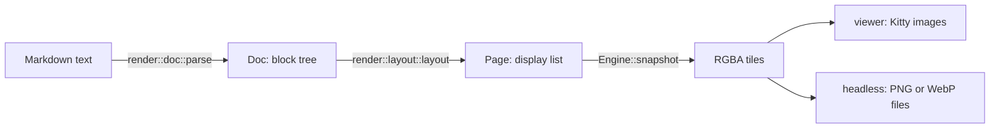

# Architecture

This file is a map of mddog's code. It says what each part does, where to find it, and which rules hold between the parts. It covers only the things that change rarely. For how a part works inside, read its module comments and code. To search for a name below, use your editor's symbol search. This file names items but does not link to them, because links go stale.

Related docs:

- `CONTRIBUTING.md`: checks, tests, releases, debug tools, and environment variables.
- `docs/behavior.md`: the contract for keys and events, with a test for each row.
- [Themes](https://mddog.pages.dev/docs/themes) on the docs site: how to write a theme.

## Bird's-eye view

mddog shows a Markdown file in the terminal the way GitHub shows it in a browser. A terminal grid of characters can't do that, so mddog draws the page as pixels and sends them as images.

The input is a Markdown file and a pane size in cells and pixels. The output is a column of image tiles. Each tile is one strip of the page, as wide as the pane, sent to the terminal with the Kitty graphics protocol. Keys and the mouse scroll, search, select, and follow links. The page reloads when the file changes.

On the way, the file goes through four forms:

mddog is one Rust binary, `mdd`, for macOS only. It uses CoreText to lay out text and CoreGraphics to draw. It has no library users. It runs in three modes:

| Mode | Started by | What it does |
|---|---|---|
| Viewer | `mdd FILE`, `mdd -`, or piped input | Draws the page in the terminal and handles keys and the mouse |
| File list | `mdd`, `mdd FOLDER`, or Ctrl-p in the viewer | Lists the Markdown files under a folder to pick from |
| Headless | `mdd --headless COLS [--webp] FILE` | Writes image files and prints JSON, for the Claude Code plugin |

The **theme** decides how the page looks. It is one file of tokens: colors, fonts, and a few sizes. A theme can recolor GitHub's look, or switch to a second look modeled on Obsidian. A theme can't change the layout rules. Those are code.

## Code map

### `src/main.rs`

The command line. It parses the options, checks the file before it takes the terminal (so a typo or a binary file gets a plain error), loads the config, refuses tmux, zellij, and Warp by their environment variables before it sends the terminal anything, and starts one of the three modes. For the viewer, standard input is copied to a private temp file first, so the viewer always reads a real file. Headless mode refuses standard input.

### `src/config.rs`, `src/theme.rs`

`config` reads the optional `config.toml` once, at startup, into a `OnceLock`. Other code reads it with `config::get()` and `config::theme()`. An unknown key or a bad value stops the run with an error that names the file, line, and key. `config.example.toml` lists every key.

`theme` reads theme files. `TOKENS` is the one list of tokens and their kinds. The built-in themes are `assets/themes/*.css`, embedded in the binary and listed in `BUILTIN`. A theme file uses CSS syntax but is not a style sheet: only `:root` rules with known tokens are allowed. A theme can name a base theme and take the tokens it leaves out from that base. `theme::Theme` holds the resolved tokens and the `Palette` for the parts drawn in terminal cells.

**Architecture invariant:** `theme.rs` holds the only SGR color formatters. Every part drawn in cells gets its colors through `Palette`.

**Architecture invariant:** there is no appearance observer. `config::theme()` reads the macOS light or dark setting each time a page is built, and a change shows on the next reload.

### `src/render/`

The renderer. It turns Markdown into pixels and knows nothing about terminals. Its parts, in pipeline order:

- `doc`: Markdown to a `Doc`, with pulldown-cmark plus a small reader for the raw HTML that Markdown files use. A `Doc` is a tree of `Block`s, and each top-level block keeps its source lines. `doc/dollars.rs` finds math with GitHub's rules before the parser runs.
- `highlight`: code to colored token runs, the way GitHub does it. tree-sitter covers a few languages, and TextMate grammars from starry-night (in `assets/textmate/`, deflated by `build.rs`) cover the rest.
- `math`: a TeX parser and box layout, with glyphs from the STIX fonts.
- `mermaid`: Mermaid source to a bitmap, through mermaid-rs-renderer and resvg. No browser and no script.
- `images`, `media`, `remote`: local and remote images. `media` decides which local files a page may show. `remote` fetches web images.
- `svg`: SVG parsing and drawing, for SVG images, diagrams, and icons. `icons`: the alert and button icons.
- `text`: fonts, text measuring, and text drawing through CoreText.
- `layout` and `page`: a `Doc` to a `Page`. A `Page` is a display list of rects, text runs, images, and paths, plus what the viewer asks about: links, anchors, headings, buttons, wide blocks, and the page's text.
- `raster`: draws the part of the display list that touches a tile, then the overlay on top.
- `theme`: flattens a `theme::Theme` into the fields that layout reads, and picks the `Look` (GitHub or Obsidian) where the two looks draw a part differently.
- `engine`: `Engine`, the one object that the viewer and headless mode call.

`Engine` is the API boundary of the renderer. It owns the fonts, the theme, the `Doc`, the images, the `Page`, and the overlay. Its main calls are `load`, `resize`, `rescale`, `snapshot`, and then one group each for search, selection, hover and presses, wide blocks, diagrams, and late images. The file also defines the types those calls take and return, such as `Layout`, `Press`, and `Select`.

**Architecture invariant:** `render` does not use `viewer`, `term`, `headless`, or `config`. It reads `theme` for the token types, `tmp` for one file-owner check, and `trace` for timing marks. The caller passes in everything else: the source, the theme, the width, the scale, and the font smoothing flag.

**Architecture invariant:** the engine keeps no bitmap of the whole page. It draws each tile from the display list when asked. So pixel memory does not grow with the page, and a tile that was freed can be drawn again.

**Architecture invariant:** the overlay (search marks, selection, hover, wide-block offsets, an expanded diagram) is separate from the display list. A change to it never needs a new layout. Only the tiles it touches are drawn again.

**Architecture invariant:** math, Mermaid diagrams, and local images are ready when layout runs, so they are in the first paint. Only remote images arrive late. They draw as their alt text first, and the page is laid out again when they arrive.

**Architecture invariant:** `render::remote` is the only code that uses the network.

### `src/viewer/`

The interactive viewer and the file list.

- `preview.rs`: `Preview`, the viewer itself. It runs the event loop, owns the `Engine`, writes to the terminal, and carries out the actions that `App` returns. `Preview::show` is the one path that draws the page.
- `app.rs`: `App`, the state machine that turns a key or mouse event into `Action`s (scroll, glide, search, contents, history).
- `chrome.rs` and `keys.rs`: the status row, the contents sidebar, and the `?` screen, drawn as terminal text from `App`. `keys.rs` is the one list of keys that the `?` screen shows.
- `cache.rs`: `Cache`, the tiles the terminal holds: their ids, the bytes they use, which to free, and the bands used under herdr.
- `position.rs`: keeps the view on the same content when the page is laid out again.
- `loading.rs`: the skeleton that shows while a slow file loads.
- `picker.rs`: the file list.
- `link.rs` and `clipboard.rs`: following links, and copying text.

**Architecture invariant:** `app.rs` holds no terminal or engine state. It depends only on `term::Key`. So it is tested row by row against `docs/behavior.md` without a terminal. `chrome.rs` is pure in the same way.

**Architecture invariant:** `cache.rs` does not write to the terminal. `Preview` passes it a function that draws a tile, so its tests use a fake.

**Architecture invariant:** the viewer never passes a local path to the system `open` command. A cloned repo could link to an app or a `.command` file. A link to a local Markdown file opens inside mddog, and only when the file is inside the repo (else the home folder, else the folder of the file shown).

### `src/term/`

The terminal layer. `term/mod.rs` sets raw mode on `/dev/tty`, probes the terminal at startup (`Tty::probe`), and parses keys and mouse reports. `kitty.rs` sends, places, and frees Kitty images, and holds the tile size limits and the storage limit. `screen.rs` reads the display's backing scale.

**Architecture invariant:** the viewer refuses to start when the terminal can't do what it needs: one that answers the probe without Kitty graphics, or a place it can't show images or scroll them: tmux, zellij, and Warp. Those three are found from the environment in `main.rs`, before the probe, because tmux takes the probe's graphics query as the pane's title. It never falls back to drawing the page as text.

### `src/headless.rs`

`--headless` mode, for hosts that own the screen and the input. It renders the whole page at a given width, writes the tiles to a private temp folder, prints one JSON line that lists them, and does that again on every file change. With `--webp` it writes small WebP tiles for Claude Code's desktop and mobile apps.

**Architecture invariant:** headless mode does not use `viewer`. It calls the `Engine` directly, as the viewer does, and takes the tile limits from `term::kitty`.

### `src/watch.rs`, `src/editor.rs`, `src/tmp.rs`, `src/sweep.rs`, `src/trace.rs`

Small helpers. `watch` watches a file's folder, so a save done as write-then-rename still counts. `editor` runs `$EDITOR`. `tmp` names and writes private temp files, and reads a temp name's pid back. `sweep` removes temp files that crashed or killed runs left behind, and prunes the remote image cache. `trace` writes the debug log that `MDDOG_TRACE` turns on.

### `src/lib.rs`

The crate root. Every module is `pub` but `#[doc(hidden)]`. The library exists only so that `main.rs` and the tests in `tests/` can reach the modules.

### `plugins/claude-code/`

A Claude Code plugin that shows a page in a pane next to the chat. It is TypeScript (`hooks/register.tsx`), not part of the Rust build. A plugin can't host a program that needs a terminal, so it runs `mdd --headless` and draws the tiles it lists. Claude Code owns the pane, its scrolling, and its input, so mddog's own keys don't work there.

**API boundary:** the `--headless` options and the JSON line it prints. The plugin and `mdd` ship apart, through the Claude Code marketplace and `install.sh`, with no version check between them. So a change on one side can break the other.

### Other folders

- `assets/`: built-in themes, TextMate grammars, and README images.
- `fixtures/`: Markdown files for manual and automated checks, such as `fixtures/gfm.md` and `fixtures/math/`.
- `tests/`: integration tests. See `CONTRIBUTING.md`.
- `reference/`: development tools in Node and Python: GitHub page capture, grammar export, end-to-end checks, and the benchmark.
- `website/`: the docs site, built with Fumadocs.
- `docs/`: the behavior spec and notes on testing in real terminals.
- `website/content/docs/`: the user docs, published at mddog.pages.dev.

## Cross-cutting concerns

### Threads

The main thread owns the `Engine`, the `App` state, the tile cache, and the terminal writes. One other thread writes to the terminal: the loading skeleton (`viewer/loading.rs`) draws its frames on its own thread until the page is ready. Both write under the `term::WRITE` lock, so their bytes never mix. The main thread blocks on one channel of `viewer::Event`s. The input thread, the signal thread, the file watcher, and the file list's walker send to that channel.

`Engine` is neither `Send` nor `Sync`: its state sits in `RefCell`s and holds `Rc` data. So only the main thread calls it. Inside `Engine::load`, highlighting, Mermaid builds, and local image decoding run on worker threads, and `load` waits for them before layout. Remote fetches run on their own pool and hand their results back through a channel that the main thread polls. Remote images are decoded on the main thread when they arrive. The highlight and Mermaid memos are thread-local to the main thread.

Headless mode has the same rule: the engine and every snapshot stay on its main thread. Besides the engine's own workers, it has a signal thread, the file watcher, and threads that encode the image files.

The viewer has no helper process, no socket, and no daemon. The only programs it runs are `$EDITOR` (through `sh -c`), `pbcopy`, and `open` for web and mail links.

### Coordinates and scale

There are two units. The engine's API takes and returns CSS pixels. The `Page` and the tiles are in device pixels: CSS pixels times the scale. The scale is the display's backing scale, times the terminal's font zoom. The page is laid out at the scale the viewer draws it at, so nothing is resampled. `Engine::snapshot` can also draw a tile at another scale, which headless mode uses for its small WebP copies.

### Keeping the place

Each top-level block keeps the source lines it came from. Before the page is laid out again, mddog records the source line at the top of the view. After, it scrolls back to the same spot. When the source changed, as on a reload or a return from the editor, it first maps that line through a diff of the old and new source. A resize, a font zoom, and a late image keep the same source and skip the diff.

### Caches

All caches are in memory and last for one process, except the remote image cache. Highlights are kept by their source text, so a reload with unchanged code doesn't highlight it again. Mermaid diagrams are kept until the next load, so a resize or a `
` toggle doesn't build them again. Fonts and laid-out text lines are kept by `render::text::Fonts`. Remote images are kept in memory and on disk under `~/Library/Caches/mddog/remote/`. `MDDOG_CACHE_DIR` moves that root.

### Files on disk

mddog has no database and never writes the file it shows. It writes:

- a copy of standard input, removed on exit.
- tile files for the terminal, which the terminal deletes.
- headless tiles in a private folder, removed on exit.
- the remote image cache.

Each temp name holds the pid of the run that made it. A SIGKILL skips cleanup, and Claude Code kills the headless process on every pane resize. So `sweep` runs once after the first paint. It removes only the temp files whose pid is gone, and the remote cache files that are too old.

### Security

A Markdown file is untrusted input.

- The engine doesn't run scripts. The raw HTML reader drops the contents of `<object>`, `<embed>`, and `<template>`. It shows `<script>`, `<style>`, `<iframe>`, and the other tags from GitHub's tag filter as plain text. Tags it knows, such as ``, `
`, and `<kbd>`, change the page. A raw `` follows the same image rules as a Markdown image. Tags it doesn't know don't change anything, and their text stays.
- Local images load only from inside one root folder: the nearest folder above the file that has `.git`, else the home folder when the file is under it, else the file's own folder. `render::media::confined_media` compares canonical paths, so a symlink or `..` can't leave it.
- Remote images never reach a private or reserved address. `remote::Checked` resolves each host, and each redirect, and refuses the host unless every address is public. The fetch then connects only to the addresses it checked, so a DNS answer that changes in between can't get through.
- Text drawn in terminal cells has its control characters replaced, so a file can't inject escape sequences.
- Text goes to the clipboard only on a copy action, or on a selection when `copy_on_select` is on.

### Observability

`MDDOG_TRACE=FILE` logs keys, renders, scrolling, placed images, and timing marks. Other `MDDOG_*` variables dump frames and tiles. `CONTRIBUTING.md` lists them all.

### Testing

Most behavior is tested below the terminal. `App` and the chrome are tested without a terminal, and the engine is tested through the same calls the viewer makes. Then a smaller set of tests runs `mdd` in a pseudo-terminal and checks what it writes. Math and TextMate output are pinned by golden files. See `CONTRIBUTING.md`.

## Glossary

| Term | Meaning |
|---|---|
| Doc | The block tree that `render::doc::parse` makes from the Markdown. |
| Page | What `render::layout` makes from a Doc: a display list in device pixels, plus links, anchors, buttons, wide blocks, and the page's text. |
| Overlay | What the raster draws on top of the display list: search marks, the selection, hover, wide-block offsets, and an expanded diagram. |
| Tile | A pane-wide strip of the page, sent to the terminal as one image. Headless mode writes it as one PNG file, or with `--webp` as two WebP files: a sharp copy and a small one. |
| Wide block | A code block or table wider than the page. It scrolls sideways on its own. The page itself never does. |
| Band | Under herdr, an image of a tile's changed rows, placed over the tile so that the whole tile need not be sent again. |
| Glide | An eased scroll to a jump target, drawn at pixel offsets. |
| Storage limit | The most tile bytes mddog lets the terminal hold. Past it, the tiles farthest from the view are freed. Tiles in view are never freed, so a view larger than the limit goes over it. |
| herdr | A terminal multiplexer built on libghostty, with a small image quota. mddog detects it and sends less image data. |
