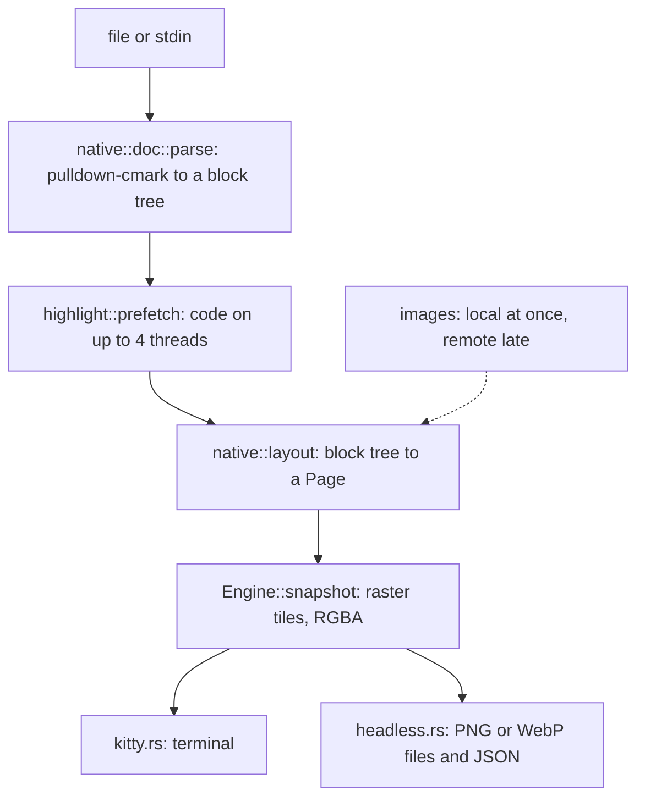
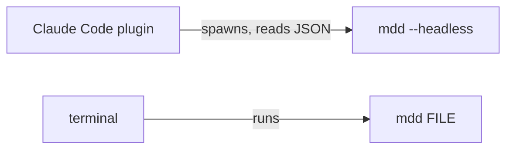
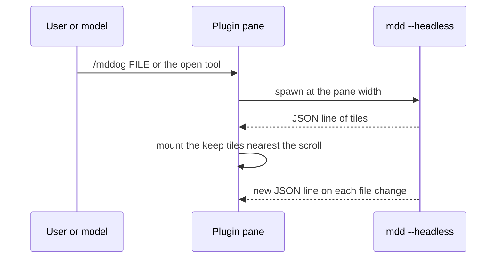

# Architecture

mddog shows a Markdown file in the terminal the way a browser shows it. It parses the file, lays the page out with CoreText, draws it with CoreGraphics into image tiles, and sends the tiles with the Kitty graphics protocol. Keys and the mouse scroll, search, select, and follow links. The page reloads when the file changes.

It is a macOS-only Rust binary, `mdd`, with no library users. It runs in three ways:

| Mode | Started by | What it does |
|---|---|---|
| Viewer | `mdd FILE`, `mdd -`, or piped input | Draws the page in the terminal and handles keys and the mouse |
| File list | `mdd`, `mdd FOLDER`, or Ctrl-p in the viewer | Lists the Markdown files under a folder to pick from |
| Headless | `mdd --headless COLS [--webp] FILE` | Writes PNG or WebP tiles and prints JSON, for the Claude Code plugin |

The **theme** decides how a page looks. It is one file of tokens: colors, fonts, and a few sizes. It can only recolor GitHub's look, as `github-light` and `github-dark` do, or restyle most of it, as `obsidian-light` and `obsidian-dark` do. By default mddog uses the GitHub pair and follows the macOS appearance. A theme can't change the page's layout rules. Those are in `src/native/layout.rs`.

Related docs:

- [docs/behavior.md](docs/behavior.md): the contract for keys and events, with a test for each row.
- [docs/themes.md](docs/themes.md): how to write a theme.
- [docs/archive/](docs/archive/design-notes.md): measurements, spike findings, and rejected approaches.

## Project structure

```
src/
  lib.rs             crate root: exports render, the other modules are hidden and serve the binary
  main.rs            CLI: options, file and stdin checks
  config.rs          optional config file: theme, live reload, smooth scroll, glide time, copy on select, Mermaid engine
  theme.rs           themes: the token list, built-in themes, theme files and bases, and the terminal chrome palette
  headless.rs        --headless: render to PNG or WebP files, for the Claude Code plugin
  watch.rs           file watcher
  editor.rs          runs $EDITOR
  trace.rs           test and debug logging
  sweep.rs           names and writes private temp files, and removes the temp files and remote cache files that dead runs left behind
  render/            highlighting, GitHub's math rules, and which local images a page may show
    markdown.rs      GitHub's math detection rules, and which local images a page may show
    highlight.rs     tree-sitter highlighting into per-line token runs, TextMate as the fallback
    textmate.rs      TextMate tokens (irosashi), each with its `pl-*` classes
  native/            the renderer (CoreText and CoreGraphics)
    doc.rs           Markdown to a block tree, with pulldown-cmark and a small raw HTML reader
    layout.rs        block tree to a Page: a display list plus the data the viewer asks about
    page.rs          the Page types: items, links, buttons, wide blocks, anchors, diagrams
    raster.rs        Page to RGBA pixels, with the overlay of search marks, selection, and hover
    text.rs          fonts, text measure, and text drawing through CoreText
    math.rs          TeX math: parser and box layout
    mermaid.rs       Mermaid source to a bitmap, with mermaid-rs-renderer and resvg
    images.rs        local and remote images, SVG and raster decode
    highlight.rs     runs render::highlight on a small thread pool with a memo
    theme.rs         the theme's tokens as the renderer uses them
  engine/
    mod.rs           the typed engine API (types, `display_scale`, `SCALE_GUESS`), and `Engine`
    native.rs        Engine: owns the fonts, theme, doc, page, and overlay, and answers the viewer's calls
  page/
    mod.rs           `PAD`, `base_dir`
    remote.rs        fetches remote images: private-address checks, worker pool, memory and disk caches
  viewer/
    mod.rs           module list
    preview.rs       the viewer: first paint, event loop, mouse, links, selection, terminal writes
    cache.rs         tile ids, resident bytes, eviction, herdr bands, placements
    app.rs           key-to-action state machine (scroll, search, contents, history)
    chrome.rs        status row, contents sidebar, and the ? screen, drawn from App
    keys.rs          the key list shown on the ? screen
    loading.rs       the loading skeleton drawn in terminal cells
    picker.rs        the file list: walk, fuzzy filter, drawing, and keys
    position.rs      keeps the view on the same content across re-renders
  term/
    mod.rs           /dev/tty raw mode, terminal probe, key and mouse parser
    kitty.rs         Kitty graphics: transmit, place, free
assets/
  themes/            built-in themes: github-light, github-dark (Primer's colors), obsidian-light, obsidian-dark
  textmate/          128 grammars from starry-night, scope-to-class map
  spike.png, mddog-themes.webp  README images
build.rs             deflates each TextMate grammar into OUT_DIR and lists them
fixtures/            gfm.md, diagram.svg, math/ (real-world math files), themes/ (sample theme files)
tests/               integration tests (help over a pty, native engine checks, search, watch, headless, math and textmate goldens)
reference/           Node and Python dev tools: GitHub capture, grammar export, e2e, bench
docs/                behavior spec, theme guide, terminal UAT notes, archive
plugins/
  claude-code/       Claude Code plugin: a pane that draws --headless output
```

## How a page gets drawn



1. The viewer or headless mode reads the file and calls `Engine::load(src, base, wrap, theme)`.
2. `render::markdown::protect_math` escapes math so the parser keeps it. `native::doc::parse` then reads the Markdown with pulldown-cmark (GFM tables, footnotes, strike-through, task lists, front matter) and a small raw HTML reader. The result is a `Doc`: a block tree plus each top-level block's source lines.
3. `native::highlight::prefetch` highlights the code blocks on a few threads.
4. `native::layout::layout` turns the `Doc` into a `Page`: a display list of rects, text runs, images, and polylines in device pixels, plus links, anchors, headings, buttons, wide blocks, and the text of the page.
5. The viewer asks for tiles. `Engine::snapshot` draws the items that touch a tile with CoreGraphics, straight into the buffer that is sent to the terminal. Headless mode writes the tiles as PNG or WebP files instead.

The config file is read once at startup, before any of this.

### Processes

The viewer is one process. It has no helper process, no socket, and no login job.



Headless mode is one process too. The plugin starts a new one on each width change.

### Threads in the viewer

The long-lived threads:

| Thread | Job |
|---|---|
| Main | Owns the tty writes, the engine, the `App` state, and the tiles. Blocks on one channel with a timeout: 8 ms during a glide, 15 ms while something is late, else 400 ms. |
| Render worker | Reads the file. It has a 64 MiB stack. |
| Input | Parses keys and mouse reports. |
| Signal | SIGWINCH becomes a resize. SIGTERM, SIGINT, and SIGHUP become a clean quit. |
| Watcher | notify's own thread. |
| Walker | Lists files for the file list while it is open. |
| Skeleton | Draws the loading skeleton until the first tiles go out. |
| Highlight | Up to 4 threads, started at the first page with code and kept. They have a 64 MiB stack. See Highlighting. |

Short side threads also pipe copies to `pbcopy`, read the macOS appearance at startup, read the display scale at startup (see Scale), and run the sweep. Up to 16 `remote` threads, started as needed and then kept, fetch remote images (see Remote images).

The engine is single-threaded by design: `Engine` keeps its state in a `RefCell`, so only the main thread calls it. Highlight and remote threads hand their results back through channels and the memo.

Input, signals, and the watcher all feed one channel. The main thread reads it and passes each event to `app.rs`, which returns actions.

A SIGINT that arrives while the editor runs is ignored. The signal handler checks whether the viewer was paused when the signal arrived, because the same Ctrl-C ends the editor, and by the time the signal thread runs the viewer may have its screen back.

## Startup and config

### CLI

`main.rs` checks the file before it takes the terminal, so a typo, a binary, or a URL gets a plain error.

- With no file and a terminal on standard input, or with a folder, it opens the file list.
- With `-`, or with no file and piped input, it copies standard input to a private temp file.
- `--help` is short and points to the `?` screen for keys. It works even when the config file is broken, because `main` loads the config only after it parses the options.
- `--headless COLS FILE` runs headless mode. Like the viewer, it stops on a broken config. `--webp` needs `--headless`.
- The viewer refuses to start in a terminal that has no Kitty graphics, and in Warp and zellij, which garble a scrolled image.

### Config

`src/config.rs` reads the optional config file, `$XDG_CONFIG_HOME/mddog/config.toml`, else `~/.config/mddog/config.toml`. `config.example.toml` lists every key.

| Key | Default | Effect |
|---|---|---|
| `theme` | `light:github-light,dark:github-dark` | One theme, or one per macOS appearance. A theme is a built-in name or a `.css` path. |
| `live_reload` | `true` | Reload when the file changes. |
| `smooth_scroll` | `true` | Jump keys glide. `false` makes every jump instant. |
| `glide_ms_per_page` | `200` | How long a glide over one screen takes. |
| `copy_on_select` | `false` | Copy a selection when the mouse button is released. |
| `file_list.extensions` | `["md", "markdown"]` | Which files the file list shows, and which ones "Did you mean" suggests. The full list, without dots, in any case. `mdd FILE` opens any text file, whatever its extension. |
| `mermaid.engine` | the theme's, else `pele` | `pele` draws diagrams in GitHub's look, `obsidian` in Obsidian's (see Mermaid). A theme names its engine with `--mddog-mermaid`, or takes its base's. |

`main` loads the file once, before the viewer takes the terminal, into a `OnceLock`. Everything else calls `config::get()`, which returns the defaults when nothing was loaded (tests, the library).

Unknown keys and bad values stop the run with one line that names the file, the line, and the dotted key. `parse` also reads the theme files, so a missing file or a bad theme stops the run the same way. A key that was removed from mddog is an unknown key like any other.

## Page look: themes

### Themes

A theme (`src/theme.rs`) is one file of `:root` tokens. The file keeps the `.css` extension and CSS's syntax, but it is not a style sheet. [docs/themes.md](docs/themes.md) lists the tokens and says how to write one. The built-ins are `assets/themes/*.css`, embedded in the binary and listed in `BUILTIN`, one line each. A new built-in is that line and its file.

| Theme | Changes | Mermaid engine |
|---|---|---|
| `github-light`, `github-dark` | Primer's colors | pele |
| `obsidian-light`, `obsidian-dark` | Obsidian's reading view: fonts, heading sizes, colors, and line height | obsidian |

`TOKENS` in `src/theme.rs` is the one list of tokens and their kinds: color, font list, heading scale, or number. A test checks that both GitHub files set all of them. The Obsidian files set only what differs and take the rest from the GitHub theme of their mode.

**Reading a theme.** `theme::parse` (built-ins) and `theme::file` (theme files) read the top-level `:root` rules of the theme. Any other rule, an unknown token, or a bad value is an error that names the file and the token. Colors are literal hex, so no CSS parser is needed. `masks` blanks comments to spaces and string contents to `x` at the same byte offsets, so a quoted `{`, `}`, `;`, or `/*` can't move a rule's edges. Font names allow only letters, digits, space, and `-_.`.

**Bases.** A theme with `--mddog-base` keeps its base (a built-in, or a file relative to its own folder). `theme::file` loads the chain and stops on a file it has already seen, by canonical path. A theme with no mode takes its base's mode, and a different `color-scheme` is an error. A token the theme leaves out comes from its base, else from `github-light` or `github-dark`, by mode. The built-ins load GitHub's two themes first, so the Obsidian ones fill in from them without recursion.

**Two types.** `crate::theme::Theme` holds the `name`, `dark`, the terminal `Palette`, the Mermaid engine the theme names, and a private map of resolved tokens. Code reads it with `color(name)`, `fonts(name)`, `number(name)`, and `heading_scale()`, where names drop the `--mddog-` prefix. `native::theme::Theme::new` flattens those tokens into plain `u32` and `f32` fields for the renderer: page colors, match and selection colors, the five alert colors, diff colors, syntax colors, font lists, heading scale, line height, and code size. `Engine::load` builds it on each load and calls `Fonts::set_families`, which clears the font and line caches when the font lists change.

**Light and dark.** `config::theme()` returns the theme to draw with: the one theme, or for a `light:...,dark:...` pair the one for the macOS `AppleInterfaceStyle` setting, read each time a page is built. The theme's `dark` flag picks Mermaid's dark colors. There is no appearance observer. A change shows on the next reload, resize, wrap toggle, return from the editor, or when help opens. Help draws in the theme's colors, so `?` reloads the page first when `config::theme()` changed.

### Terminal chrome colors

The terminal parts draw with the theme's `Palette`: the file list, the status bar, the contents sidebar, the `?` screen, the screen clears in `Preview::show`, and the loading skeleton. `Palette::reset()` is `\x1b[0m` plus the background. Every drawer uses it in place of a plain `\x1b[0m`, so the cells between spans keep the theme's background. `theme.rs` holds the only SGR color formatters. The file list has no page, so it calls `config::theme()` at each draw.

## Rendering

### Doc

`native::doc::parse` turns the source into a `Doc`. It runs on the main thread inside `Engine::load`.

- `protect_math` (in `render/markdown.rs`) runs first. See Math.
- pulldown-cmark reads the Markdown, with offsets. The block tree (`Block`) has paragraphs, headings, code, quotes, GitHub alerts, lists with task boxes, tables, rules, math, Mermaid, `<details>`, aligned blocks, and footnotes. Inline content is flat runs with style flags (`Sty`): bold, italic, strike, code, kbd, sub, sup, underline, mark, and a link index.
- A small tokenizer reads the raw HTML that Markdown files use: `<details>`, `<summary>`, `<p align>`, `<div align>`, `<br>`, ``, `<kbd>`, `<sub>`, `<sup>`, `<mark>`, `<ins>`, and similar. The contents of `<script>`, `<iframe>`, `<style>`, `<object>`, `<embed>`, and `<template>` are dropped. Other tags have no effect of their own, and their text stays. Text that sits in a raw HTML block outside a `<p>` becomes `Block::Text`, which draws like a paragraph with no gap below it, as a browser draws it.
- `lines` holds the 1-based source lines of each top-level block, from the parser's offsets. This is how the viewer keeps its position (see Position keeping).
- Front matter becomes a table with an empty head row (`front_matter_rows`). Raw URLs become links (`autolink`). Heading ids come from `slug`.
- An empty file becomes `*This file is empty.*`.

### Layout

`native::layout::layout` walks the `Doc` once and writes a `Page`. All numbers are device pixels: CSS pixels times the scale. The page is 24 CSS px padded (`page::PAD`).

- **Display list.** `Page::items` is a list of `Item`s: a rect (fill, stroke, radius), a text run, an image bitmap, or a polyline. Each item has a clip number. 0 means fixed, and any other number points to a wide block.
- **Text.** `native::text::Fonts` measures and draws through CoreText. It keeps a cache of fonts, and one of laid-out lines. The theme's font list gives the family, first choice first. Words wrap by their measured width, and CJK text breaks between characters.
- **Data for the viewer.** `Page` also keeps the page's text as one `Vec<char>` (search and selection index into it), the link rects and URLs, heading anchors, the heading list for the contents sidebar, the source blocks with their tops and heights, the buttons, the toggles for `<details>`, and the images still wanted.
- **Wide blocks.** A code block, a table that is wider than the page, or a diagram that is wider than the page gets an `HScroll` entry: its box, its largest offset, and its scroll bar. Its items have that entry's clip number, and the raster shifts them by the offset. With wrap on (`w`), code wraps and gets no entry.
- **Buttons.** Each code block gets a copy button. Each diagram gets copy, expand, zoom-in, and zoom-reset buttons, sized and placed as GitHub does.
- **Details.** A closed `<details>` lays out only its summary. A click on it toggles the block by id and lays out again.

### Raster

`native::raster::render_into` draws the items that touch a tile with CoreGraphics into an RGBA buffer, then draws the overlay on top: search marks (the current match in another color), the selection, button hover and "Copied!" state, the scroll bars of wide blocks, and the expanded diagram. The overlay lives outside the display list, so a search or selection change never needs a new layout. Text is drawn with antialiasing and sub-pixel positions, and with font smoothing off. `Engine::snapshot` takes a CSS-pixel range and a scale, and draws at that scale even when it differs from the layout scale (headless uses this for its small WebP copies).

### Engine

`engine::Engine` (`src/engine/mod.rs` re-exports `native::Engine`) is the one object the viewer and headless mode call. It owns the fonts, the theme, the `Doc`, the images, the `Page`, and the overlay. Coordinates in and out are CSS pixels. A `Rect` is `[x, y, w, h]`. It is not `Send`, so only the main thread uses it, and every method takes its `RefCell` borrow inside the method.

| Group | Calls |
|---|---|
| Page | `new(width, scale)`, `load(src, base, wrap, theme)`, `resize(width)`, `rescale(scale, width)`, `layout()`, `anchor_y(id)`, `set_wrap(bool)` |
| Tiles | `snapshot(y, h, scale)` |
| Search | `search(query, keep)` returns the rects of every match, `search_current(i)` returns the rects of the old and the new current match, `search_clear()` |
| Mouse | `hover(x, y)` returns the pointer shape and the rects of buttons whose hover changed, `link(x, y)`, `press(x, y)`, `reset_copy()` |
| Selection | `select(Select)` with `Range`, `Word`, or `Clear`, `selection_text()`, `has_selection()` |
| Wide blocks | `code_grab`, `code_drag`, `code_release`, `code_scroll`, `code_scroll_view`, `code_positions`, `code_restore` |
| Diagrams | `expand(i, top, height)`, `collapse()` |
| Late images | `pending_images()`, `images_done()`, `wait_images(timeout)` |

`layout()` returns a `Layout`: the source blocks with their top and height, the text of each block (for position keeping), the headings, and the page height. `press` returns a `Press`: `Nothing`, `Copy { text, rects, label }`, `Expand(i)`, or `Other`, which means the page changed and the viewer must measure again. `select` returns how many rects the old selection had, then the old rects followed by the new ones, so the herdr band path can split them. The calls that change what is drawn return the CSS rects to redraw, and the viewer sends only the tiles (or bands) they touch.

Each call is a direct method call. Nothing is parsed or sent between the viewer and the engine.

### Scale

Layout needs the display's backing scale. `engine::display_scale()` reads it from CoreGraphics (`CGDisplay`), which needs a window-server connection (about 25 ms) but runs off the main thread and starts no AppKit. It is a `OnceLock`.

- The viewer starts it on a thread at launch. The first page lays out at `SCALE_GUESS` (2.0, which every Mac screen since 2016 has except an external 1x display) while that thread runs.
- `Preview::settle_scale()` runs in `render_doc` right after the load. When the real scale differs from the guess, it fixes the scale, the cell pixels, the page width, and the loader, and calls `Engine::rescale`. That lays out again before anything is drawn.
- With several displays at one scale, that scale wins. With mixed scales, the scale of the display that holds the frontmost window wins, because that is where the terminal was typed into. If that lookup fails, the main display wins.
- Headless mode starts with `display_scale()` directly.

### Highlighting

Code is highlighted in two steps. `render::highlight` (tree-sitter) and `render::textmate` (irosashi, a Rust port of vscode-textmate) classify code the way GitHub does, with `pl-*` classes. `render::highlight::block` maps each class to a token (`Tok`: keyword, string, comment, number, function, type, punctuation, added, removed, meta) and returns per-line runs. Layout then colors each token with the theme's syntax colors.

- tree-sitter covers JS, TS, TSX, Python, Rust, Go, Ruby, CSS, HTML, and PHP. TextMate covers the rest with 128 grammars from starry-night. `tests/textmate.golden` pins the TextMate output.
- Grammars are embedded deflated. `build.rs` compresses each one into `OUT_DIR` (2.9 MB to 0.54 MB) and lists them by scope. A page inflates only the grammars it needs, and the highlighter is built again when a new language's include chain adds grammars. It reads a grammar's header when it registers it, and parses the grammar when tokenizing first reaches it.
- A code block that has no known language, or that fails, falls back to a small keyword, string, and comment highlighter in `native/highlight.rs`. `MDDOG_NATIVE_HL=b` forces it.
- **Pool.** `prefetch(doc)` runs inside `Engine::load`. It sends each code block (language and text) to one of 4 threads (`WORKERS_MAX`). A language always goes to the same thread, in the order languages first showed up, so the first use of each language (a query compile or a grammar load, up to about 12 ms) runs beside the others. The threads live on, so a compiled language serves later pages. A made-up fence label can't start more than 4 threads, and the table of language slots is cleared at 256.
- **`MEMO`.** The results go into a thread-local `MEMO`, keyed by language and text. `highlight()` reads `MEMO` first and computes on the calling thread only on a miss. `prefetch` keeps the old page's entries it can reuse, so a reload with unchanged code costs nothing.
- A closed `<details>` lays out its body only when opened, so its code is highlighted then.
- The threads and the file reader have a 64 MiB stack (`render::STACK`).

### Math

Math is found by GitHub's rules, then laid out by mddog's own TeX layout.

**Detection.** `render/markdown.rs` holds GitHub's rules. `protect_math` is a pre-pass on the source, line by line, that knows its containers. cmark-style parsers drop a backslash before punctuation and read `*` and `_` in math as emphasis. So `protect_math` escapes those inside each math span, and holds an escaped `\$` as `HELD_DOLLAR` until the doc is built. It finds spans with `inline_math(_, loose = true)`, which finds every span the later pass finds and more, so it never misses math that will be typeset. It skips raw HTML blocks, code spans, spans that hold a URL, and text outside the span's block quote or table. Then `doc.rs` splits each text run with `inline_math(_, false)`.

`inline_math` follows GitHub's rules. An opener follows whitespace, `(`, or the start of a text node. The first `$` after it closes the span unless it comes before a word character, sits between two of the same mark, or follows a space and comes before a space or the end. A span never crosses a line. Both passes take linear time.

mddog differs from GitHub on purpose in a few places. Math inside italics and footnotes renders, `\$` stays a literal dollar, and five GitHub math bugs are not copied. `fixtures/math/SOURCES.md` lists the exact inputs, and `tests/math.golden` holds the expected lines. An inline HTML tag that follows text pushes a private-use marker (`HTML_BREAK`, U+E025), so `finish_inlines` can split math at the tag. It never reaches layout.

**Layout.** `native/math.rs` parses TeX into a tree of nodes (`N`) and lays it out as boxes (`MBox`: width, ascent, descent, and a list of glyph runs, rules, and polylines).

- Glyphs come from the STIX fonts through CoreText. Fraction bars, roots, accents, wide arrows, and braces are rules and polylines, so they don't need a font glyph and stretch freely.
- Spacing follows TeX's table (`class_space`) for atom classes such as ordinary, operator, binary, relation, open, close, and punctuation. A binary operator with no left operand is treated as ordinary.
- `St` carries the style: display or text, script level, and the font code (roman, bold, double-struck, script, bold italic, italic, fraktur, sans, mono). It also carries a `script` flag for sub- and superscripts, limits, inline fraction parts, and roots.
- It handles fractions, roots, sub- and superscripts, big operators with limits, delimiters, matrices and aligned environments, stacked symbols, extensible arrows, accents, and `\text`.
- Placement of accents uses a letter-height guess from the node's characters, because the layout has no glyph bounds.
- Unknown commands are noted in a thread-local list (`take_unknown`) for tests and debugging.

Math is laid out in place, so the first paint includes it. There is nothing to wait for.

Known gaps are small and readable: script letter shapes differ from TeX's, `\mathop{...}\limits` puts scripts beside the operator, and a few accents sit lower than they should.

### Mermaid

`native::mermaid::render` draws a diagram in two steps. mermaid-rs-renderer lays the diagram out and writes SVG, and resvg draws that SVG into a bitmap. Both run in process, with no browser and no script. Layout calls it for each Mermaid block, so diagrams are in the first paint. A diagram that fails to draw shows its source as a code block.

**Engine key.** `config::mermaid(theme)` picks `pele` or `obsidian`: `mermaid.engine` if set, else the theme's `--mddog-mermaid` (inherited from its base), else `pele`. On this renderer the key only picks the diagram's look:

| | pele | obsidian |
|---|---|---|
| Look | GitHub's: light or dark mermaid-rs-renderer palette, blue accent, muted lines | Obsidian's: the theme's accent colors the node borders |
| Used by | GitHub themes | Obsidian themes |

In both, the background, text, line, and cluster colors come from the theme's tokens (`pre-bg`, `text`, `fg-muted`, `code-bg`, `alt-bg`, `rule`). The font is Helvetica, from the system, because resvg has its own font database (`images::fontdb`).

**Buttons, expand, and zoom.** Each diagram sits in a box like GitHub's, with copy, expand, zoom-in, and zoom-reset buttons.

- A diagram wider than the box scales down to fit. At a zoom above 1 it can be wider than the box, and then it scrolls sideways like a wide code block.
- Zoom-in multiplies the zoom by 1.25, up to 4. Zoom-reset clears it. Both lay the page out again, which draws the diagram again at the new size, and return `Press::Other`. The zoom lives in `St::zoom`, by diagram index, and a load resets it.
- Copy puts the diagram's source on the clipboard.
- Expand returns `Press::Expand(i)`. The viewer calls `Engine::expand(i, top, height)` with the visible rows. The engine draws the diagram again to fill the view, with 16 px padding, centered, as GitHub's expanded view does. That bitmap goes into `Overlay::expanded`, which is drawn last. `App::expanded` makes the next key or click call `collapse()`. A load clears it.
- Diagram text can't be selected or searched.

### Images

`native::images::Images` loads each image the layout asks for, by its `src`.

- **Local files** load at once, during layout. They are confined to a root folder (see Security) by `render::markdown::confined_media`. A path outside the root, a path that isn't a file, or bytes that don't decode make the image fail.
- **Decode.** SVG goes through resvg (`usvg`), so it stays sharp at any size. PNG, JPEG, GIF, and WebP go through the `image` crate and are premultiplied. An image wider than its line is scaled down to the line's width.
- **Remote images** (`http` and `https`) are not fetched during layout. The layout draws each as its alt text and records the URL in `Page::wanted`. After the layout, `Engine::load` passes them to `Images::fetch`, which queues each on `page::remote`. Each `Images` has a stop flag per fetch, and its `Drop` sets them, so a reload ends the fetches of the page it replaces.
- **Late.** When a fetch ends, the image is decoded on the main thread by `images_done()` (which the viewer polls) or `wait_images()` (which headless calls), and the page is laid out again. A failed fetch leaves the box as it was, with no layout change. `pending_images()` says how many are still loading.
- An image with a `width` attribute keeps it. An image that is still loading, or failed, shows its alt text in muted italics, or `[image]` when it has none.
- The viewer gives remote images 60 s (`LATE_LIMIT`), and keeps its position when the page grows. Headless mode gives them 4 s (`REMOTE_LIMIT`) and draws what it has.

### Remote images

`page::remote` fetches them. It is the only code that touches the network.

- `spawn` queues each fetch for a pool of up to 16 worker threads, started as needed and then kept. A worker takes the oldest job whose host has fewer than 6 running (`PER_HOST`), so one busy host doesn't hold up the others. A job whose stop flag is set while it waits is dropped without a fetch. A job that panics is caught, so the worker keeps going.
- `fetch` uses ureq with native TLS. It follows up to 5 redirects (`HOPS`), takes up to 30 s, and connects within 5 s. It sends a `mddog/<version>` user agent with a contact URL, because Wikimedia answers 429 to one without. A proxy from the environment is ignored, since ureq would resolve the proxy instead of the host.
- **Private addresses.** ureq resolves through `Checked`. It refuses a reserved name (`.local`, `.localhost`, `.internal`, `.lan`, `.home`, `.home.arpa`, `.intranet`, `.corp`, or a name with no dot) and returns a host's addresses only when every one is public (`private_ip`). ureq connects only to the addresses it returns, so the address checked is the address used. Each redirect hop resolves through `Checked` again. That also closes DNS rebinding.
- Only `image/*` and octet-stream bodies are passed on, up to 32 MiB (`MAX_BODY`). Every fetch is a plain GET of the whole body.
- **Memory cache.** Whole responses stay in memory, up to 64 MiB, oldest out first, for their `max-age`, between 1 minute and 1 hour, else 5 minutes. A live reload asks for every image again on each save, so even `max-age=0` is kept a minute. `no-store` is not kept.
- **Disk cache.** A whole response is also written to `~/Library/Caches/mddog/remote/<hash>`: a JSON line with its URL, type, and expiry, then the body. It goes through a temp file and a rename, so a reader never sees half a file. A reopen in a new process skips the network. The sweep removes it (see Sweep).

## Drawing in the terminal

### Tiles

Tiles are pane-wide, a whole number of cell rows tall, and at most 8 MiB (`TILE_BYTES`) and 10,000 px tall each (`MAX_IMAGE_SIDE`: Ghostty and herdr's libghostty-vt refuse a taller image).

**Transfer.** The startup probe picks the route: shared memory, then a temp file under `$TMPDIR`, then PNG chunks. PNG is the only route over SSH, where it makes a tile about 30 times smaller. macOS limits shm names to 31 characters.

**Placement.** Each visible tile gets one placement with a source rect. Scrolling moves the source rect inside a synchronized update. A tile that scrolls out loses its placement by placement id (`a=d,d=i,i=<id>,p=1`), because iTerm2 frees the image itself on a `d=i` without `p`, and the tile then comes back blank.

Each tile is sent with one extra cell row below it, a copy of the next tile's first row (the last tile has none), for glides. A tile plus its extra row stays under both size limits.

**Storage limit.** mddog keeps the tile bytes the terminal holds under a limit:

| Terminal | Limit | Why |
|---|---|---|
| herdr (XTVERSION starts with `libghostty`, or `TERM_PROGRAM=herdr`) | 56 MiB | herdr's quota is 64 MiB |
| anything else | 300 MiB | other terminals hold about 320 MB |

Past the limit, the tiles farthest from the view are freed and re-sent when needed. Visible tiles are never freed. So a view larger than the limit on its own (a full-screen pane on a 5K display under herdr) goes over it, and herdr then drops the oldest images.

**Pixels.** `Engine::snapshot` makes a zeroed shm buffer (its size rounds up to whole pages) and CoreGraphics draws straight into it, so a tile needs no pixel conversion and no copy. A tile is drawn at the display's scale. The page is laid out at that scale too, so nothing is resampled. The engine keeps no image of the whole page: it draws each tile from the display list when asked. So memory does not grow with the page, and a tile that was freed is drawn again from the list.

### Bands under herdr

herdr copies every image, and its client sends it on to Ghostty as base64, so re-sending an 8 MiB tile is expensive. So under herdr (the same check as the storage limit), a selection or search change does not re-send the tiles it touches. Instead, the changed rows, snapped to whole cells and full pane width, go out as a **band** image placed over the tile at `z=1`.

- `viewer/cache.rs` owns tile ids, the resident byte count, eviction, bands, and placements. `Preview` writes what it returns to the terminal and passes it a snapshot closure, so its tests use a fake. Every subtraction from the resident count uses bytes that `Tile::release` or a band added before.
- A tile keeps its bands in `Tile::bands`. A new change that touches a band replaces it with one band over both (`join_bands`). The tile's byte count includes its bands.
- Bands are placed with the tile on every frame, cropped to the view, so they move with it on scroll. `Tile::release` frees a tile and its bands together.
- A tile goes out whole again, which removes its bands, when it would hold more than 4 bands or bands over half its rows, when it changes while out of view, 1 s after the last input, or when it is re-sent anyway (reload, resize, eviction, help).
- For a drag, `Preview::selection_js` counts only the rects that differ between the old and the new selection, so a long drag sends only the rows at its moving end.

### Glides

A glide (see Keys and scrolling) draws the view at any pixel offset, not only on cell rows. But a placement can't start or end between cell rows exactly. Ghostty draws a placement `r * cell_h - Y` pixels tall from the cell top plus `Y`, and herdr 0.9.5 rewrites `c` and `r` from its own grid as `ceil((h + Y) / cell_h)`. So under herdr, a piece whose bottom falls between rows is stretched. Instead, every placement starts and ends on a screen row:

- Screen row `r` shows the page from `scroll_px + r * cell_h`. `cache::rows` gives the rows each image draws.
- A tile draws the rows that start inside it. The last of those can cross into the next tile, and the tile's extra row covers that part.
- A band is sent with one extra row above and below (`Band::src`), and draws every row it touches.
- So each placement's source height is `rows * cell_h`, with no `Y=` and no rescale, and `kitty::place` is the same as for whole-row scrolling. At a whole-row offset the placements are the same as before glides existed.
- A change in a tile's extra row also re-sends that tile, or under herdr gives it a band.

### First paint

The main thread probes the terminal while the worker reads the file. The probe sends CSI 16 t, XTVERSION, DECRQM for modes 2026 and 1016, a Kitty `a=q` query, then DA1, and waits up to 1 s.

- `Engine::new` makes no window and starts no framework, so it takes almost no time. The load, which is parse, highlight, and layout, is the first real cost. A trace of a cold start, with the stand-in terminal, shows layout at about 15 ms, highlighting at about 14 ms (bounded by the slowest language's query compile), and raster and send at about 10 ms. The page reaches the terminal in about 40 ms of mddog's own time.
- The page lays out at `SCALE_GUESS` while a thread reads the real scale. `settle_scale` fixes a wrong guess before anything is drawn (see Scale).
- The first snapshot covers only the first viewport. The other tiles follow in idle time.
- Math and Mermaid diagrams are laid out with the page, so they are in the first paint.
- Local images are in the first paint. Remote images are not waited for (see Images). The page shows each one's alt text, and the late re-send shows the image when it arrives.
- Anything that finishes late is laid out again, with the position kept (`Preview::relayout`).

A side thread reads the macOS appearance at startup, because the first `config::theme()` call for a theme pair sets up NSUserDefaults, which is slow.

### Loading skeleton

While a file loads, `Loader` (`loading.rs`) draws a page-shaped skeleton in terminal cells: a heading bar, text lines, and a code block, with a diagonal shimmer that moves every 100 ms.

- It draws only when the page is not ready after 100 ms (`DELAY`), so a warm start usually finishes before it shows.
- Once drawn, it stays at least 100 ms (`MIN_SHOWN`), so it never flashes.
- The margins are the page's 24 CSS px padding times the screen scale, over the cell size. The colors come from the theme.
- `Loader::tune` takes the probe's answers. A resize redraws the frame in full.
- `show()` calls `finish()` after the tile snapshots, so the minimum wait overlaps that work, and the clear and the first tiles go out in one synchronized update.
- The `term::WRITE` lock covers each whole write from `Tty::write` and the loader, so a frame can't split the probe query.
- Opening a file from the file list, or going back to the file before, starts a new `Loader` before the file is parsed. Its first frame clears the screen, so it replaces the list. The file list itself has no skeleton.

## Interaction

### Keys and scrolling

`app.rs` is pure. It turns a key or mouse event into actions and holds no terminal or engine state, so it is unit tested row by row against [docs/behavior.md](docs/behavior.md). `chrome.rs` draws the status row, the sidebar, and the `?` screen from `App`, so they are tested without a terminal too. `preview.rs` carries out the actions.
**Resize.** Resizes are debounced by 120 ms. A resize or contents toggle reuses the file's bytes when they still match. A resize lays the live page out again instead of loading it (`Preview::resize_in_place`): it calls `Engine::resize`, which lays the same `Doc` out at the new width, measures, and scrolls to the same content anchor a reload uses. A resize takes a few milliseconds, because it re-parses nothing. It falls back to a full reload when the result could differ from a fresh load:

- The file changed (with live reload on), or the macOS appearance changed under a theme pair.
- A click changed the page (a copy, a `<details>` toggle, a zoom), text is selected, or a diagram is expanded.
- The page was not loaded yet.

**Glides.** The jump keys glide: `d`/`u`, `f`/`b`, Space, PageUp/PageDown, `g`/`G`, Home/End, Backspace/Ctrl-o, digits, `J`/`K`, `]]`/`[[`. `App::handle` turns their `Action::Scroll` into `Action::Glide`. The keys in `App::instant` (`j`, `k`, `n`, `N`, Enter, the wheel) move at once. `App.scroll` takes the target at once, so the status row and sidebar show where the view is going. Only the drawn offset moves.

- `app::Glide` eases out (cubic) from where the view was drawn to the target. It is time-based, so a late frame skips ahead and the glide still ends on time. It covers at most one screen, so `G` from the top glides only the last screen. A jump during a glide starts a new one from the drawn offset, and may cover one screen more than the old glide had left, so quick repeated presses never skip.
- `app::Pace` sets the time. A glide over one screen takes `glide_ms_per_page`, and a shorter one takes its share. A jump key within 100 ms (`REPEAT`) of the last one glides in 50 ms (`FAST_GLIDE`), like snacks.nvim's `animate_repeat`. Holding `f` keeps the view 1.4 to 1.9 screens behind the target, with no frame moving more than one screen.
- `Preview` holds the running glide, `drawn` (the offset `show` last drew, where a new glide starts), `path` (the tiles a new glide passes over), and `last_jump`. `shown_px()` feeds `view()`, `grid()`, and `view_css()`, so drawing and mouse hits use the drawn offset, while `scroll_px()` stays the target everywhere else.
- `start_glide` jumps instead when `smooth_scroll` is off, the terminal lacks mode 2026, or the path's tiles don't fit in the storage limit together (`Cache::fits`, bands included). The first `show()` sends the path's missing tiles inside its synchronized update and keeps them from eviction. Then it restarts the glide clock, so a slow send doesn't shorten the glide.
- While a glide runs, the event loop wakes every 8 ms and `tick()` advances it, skipping frames that land on the same pixel. The glide ends on the first frame that reaches the target, which the easing gives a frame or two before its time runs out. Prefetch and the hover check pause.
- `settle()`, `Action::Scroll`, `Action::Search`, a resize, an instant key, a mouse press, help, and the file list end a glide. A press ends it before it is handled, so the press and its release hit the same page point. `show()` uses `path` only while a glide runs, so a glide that ended before its first frame doesn't leave stale tile indices behind.
- The trace's `view` line starts with `px=` (the drawn offset) and `took=` (ms in `show()`).

**Pixel mouse.** When the probe finds mode 1016, the terminal reports the mouse in pixels, not cells. `Preview::spot` turns each report into its cell plus where it falls inside that cell. So the status row, the sidebar, and double clicks still work in cells, while links, word selection, and code scroll bars are hit at the exact point. Without 1016 the point is the cell's center.

**Kitty keyboard.** The viewer pushes kitty keyboard flag 1 (`term::KEYS_ON`, `ESC[>1u`) after it enters the alternate screen, and pops it (`term::KEYS_OFF`) before it leaves, in `term::leave()` and `Preview::leave_screen`, since each screen keeps its own flag stack. Flag 1 is the only flag that makes the terminal send Cmd-c (`CSI 99;9u`). It also turns Ctrl-letters and Esc into CSI-u forms, so `term::csi_u` maps those back to the `Key` their legacy bytes give, and the rest of the viewer doesn't see a difference. The one new key is `Key::Copy`, which `App` turns into `Action::CopySelection` in every mode. There is no `CSI ? u` probe: a terminal that ignores the push keeps sending legacy bytes, which parse as before.

**Contents scroll bar.** When the contents list overflows, the sidebar's last `app::TOC_BAR` (3) columns hold its scroll bar: a thin line on each side and a thin thumb between them. A list that fits keeps one separator column. `App::toc_thumb()` gives the thumb's top and length, and both `Chrome::sidebar` and the hit tests (`App::toc_bar_press`, `toc_bar_drag`) use it, so what is drawn and what is hit agree. `App::toc_grab` holds the thumb row the pointer grabbed. `preview.rs` only routes by column: a list-row press within 3 columns of the sidebar's edge goes to the bar, and the wheel at `col <= img_col` scrolls the list. `Key::WheelUp` and `Key::WheelDown` carry their cell for this.

### File list

`picker.rs` holds the list. `Picker` keeps the items, the filter, and the selection, and `draw` paints the list over the whole screen as terminal text, as the `?` screen does. `preview::browse(root)` starts with the list and no document. It draws the list right after raw mode, before the engine starts and before the terminal probe, and waits up to 50 ms for the first batch. Ctrl-p (`Action::Browse`) opens the same list over a file and keeps the last filter.

- **Root.** `scope` picks the nearest folder with `.git` above the start, else the current folder. `mdd` starts from the current folder, and Ctrl-p from the open file's folder (the current folder for standard input). A folder argument is the root itself. Each Ctrl-p calls `Picker::follow`: when the open file is outside the current root, the root becomes `scope` of the file's folder, and the filter is cleared. A file under the root keeps it, so a list of a plain folder, or of a folder that holds several repos, stays put.
- **Walk.** A walker thread uses `ignore::WalkBuilder` with `require_git(false)`, so it skips hidden and gitignored files with or without git. It keeps files whose extension is in `file_list.extensions` (`.md` and `.markdown` by default) and stops at 10,000 (`CAP`), in walk order. It sends a batch every 30 ms with `term::Event::Listed`, which wakes the event loop. An `AtomicBool` stops the walk when the list closes or restarts.
- **Titles.** `title` reads the first ATX heading from each file's first 4 KiB. Setext headings and headings after long front matter don't give a title.
- **Filter.** `nucleo-matcher` scores `path + " " + title` as one string. `Picker` splits the match positions back into the path and the title for highlighting. The filter takes fzf's syntax (`!`, `^`, `'`, `$`).
- **Switching files.** `open`, `switch`, and `back_file` change files inside one `Preview`. `open` pushes a `Visit`: the file, the stdin flag, the name, the whole `App`, a position anchor, and the source. The history holds 50 (`HISTORY`). `switch` resets the document state, restarts the watcher, and calls `render_doc`, which maps `restore_at` through a line diff as a reload does. The new `App` keeps `wrap` and `toc_visible`.
- **Back.** Backspace and Ctrl-o first go back through jumps in the current file. With none left, `App` emits `Action::BackFile`, and `back_file` returns to the file before at its old position. A file that can't be read is dropped from the history, so older files stay reachable.
- When the list is up, `show()` frees the tiles and draws it, and `draw_chrome` and `prefetch_target` skip. Opening a file renders it on the main thread, as a reload does.

### Position keeping

Every top-level block carries its source lines (`Layout::blocks`, from pulldown-cmark's offsets), and the layout gives each block its top and height. Before a re-render, mddog records the source line at the top of the view and the offset into its block. Afterwards it maps that line through a line diff of the two sources (`similar`) and scrolls back to the same spot.

### Search

`Engine::search` finds every occurrence in the page's text, across inline elements and soft wraps, with smart case (any uppercase letter makes it case-sensitive). The match is literal, and runs of whitespace in the query match any run of whitespace. A match never crosses a block. The engine draws the matches as overlay marks, so the layout does not change.

- `search` returns the rects of every match, so the viewer can find which rows hold one. `search_current(i)` moves the current match and returns the rects of the old and the new one, so only their tiles are sent again. Under herdr only the changed rows go out, as a band.
- A match inside a wide block that is scrolled away scrolls the block sideways until it shows (`reveal`). The returned rects then include the block.
- A change in the overlay needs no layout and no wait for a frame. The tile is drawn again from the display list with the marks on top.
- A relayout clears the matches, and the viewer runs the query again (`rerun_search`) with the current match kept.

### Wide blocks

Code blocks, wide tables, and zoomed diagrams scroll sideways on their own. The page root is never scrolled. Each one has an `HScroll` entry in the `Page` and an offset in the overlay (`Overlay::hoff`), and the raster draws its clipped items shifted by that offset. The engine draws the bar (an `HScroll::bar_y` track and a thumb), because nothing else does.

- Shift + wheel (`code_scroll`), `h` and `l` (`code_scroll_view`, for every wide block in view), and dragging a bar (`code_grab`, `code_drag`, `code_release`) change the offset. Only the affected tiles are sent again, because each call returns the block's rect.
- A press on the thumb holds it where it is. A press on the track centers the thumb there first. The grip keeps the thumb under the pointer in a drag.
- `code_positions` saves the offsets as a list in page order, and `code_restore` puts them back after a reload, so a reload keeps each block where it was.
- `w` toggles wrapping for all code blocks (`set_wrap`), which lays the page out again.

### Mouse, links, and selection

Clicks map from cells to page CSS pixels. On release, mddog tries a link (`link()`), then a button or toggle (`press()`). Links open with `open`, or jump to a heading. Drag and double-click select text and draw the selection. Releasing copies nothing unless `copy_on_select` is on.

**Selection.** `Select::Range` takes the anchor and focus points, finds the characters under them in the page's text (`hit_char`), and selects between. `Select::Word` selects the word at a point. The selection is an overlay too. A relayout clears it, so a click that lays out again drops it.

**Copy buttons.** Layout puts a copy button at the top right of every code block. A click copies the block's text. The button draws a hover state and a "Copied!" tooltip, and `reset_copy` clears the tooltip. Mermaid diagrams have their own copy button, which copies the source.

**Copying.** Every copy goes through `Preview::copy_text`.

1. It strips control characters (`pasteable`).
2. It writes OSC 52 to the tty, so the copy reaches the clipboard of the terminal the user sits at (also over SSH, and through herdr, which shows its own notice). The write runs on the main thread between frames, so it never splits a tile write. It has no size cap: Ghostty under herdr drops one over about 220 KB, and `pbcopy` still covers the local clipboard.
3. It pipes the text to `pbcopy` on a thread.

`Preview::copy_selection` copies `Engine::selection_text`, for Cmd-c and for a release when `copy_on_select` is on.

**Hover.** Mode 1003 reports moves with no button held (`Click::Move`), and mddog does hover itself.

- `Preview::hover` hit-tests a move only when it reaches a new spot (`hover_at`: the spot plus the drawn offset), through `Engine::hover(x, y)`. That returns the pointer shape and the rects of the buttons whose hover changed.
- The hand shows over links, buttons, and `<details>` summaries. The text cursor shows over text. The default arrow shows elsewhere.
- The event loop keeps only the last of a run of queued moves. Any other event marks `hover_at` stale, and the loop hit-tests again once no drag is held and no glide runs. It checks after `tick()`, so a glide's last frame is hit-tested at once. So a scroll, help, a relayout, or a new page updates hover under a still pointer.
- The hit test runs after `show()` sends the frame, and shows again only when the hover changed a button. It is a direct call, so it costs microseconds.

**Pointer shape.** `set_pointer` sends OSC 22 only when the shape changes: `xterm` over text, the hand over links and controls, `left_ptr` elsewhere. The hand is `Probe::hand()`: `hand2` for iTerm2, which knows only X11 names, and the W3C `pointer` for the rest, since Ghostty has no `hand2`. kitty takes both. `MOUSE_OFF` ends with an empty OSC 22, so every way out of the screen resets it. herdr and WezTerm drop OSC 22. herdr parses it and never forwards it, and its maintainers closed the request to add that (herdrdev/herdr#5279), so mddog doesn't work around it.

**Expand.** A diagram's expand button makes `press()` return `Expand(i)`. The viewer calls `Engine::expand(i, top, height)` with the visible rows (see Mermaid). The engine draws the diagram again to fit the view and puts it in an overlay over those rows. `App::expanded` makes the next key or click call `collapse()`. A load clears it.

**Task checkboxes.** The viewer is read-only, so a click on a task box does what a click on plain text does. Layout draws the box as GitHub draws a disabled one: 13 px, gray, set left of the text's indent.

### Editor, watching, and suspend

`e` leaves the alternate screen, runs `$EDITOR` (or `vi`) through `sh -c`, then re-renders with the position kept. The shell exits 127 when it can't find the program, which is how the status row reports a bad `$EDITOR`. A preview of standard input has no watcher, and `e` shows `Can't edit standard input`.

The watcher watches the parent folder, so a save done as write-then-rename still counts. It reloads only when the content changed. With `live_reload = false` the watcher does not start.

On Ctrl-z the viewer also leaves the alternate screen. It sends SIGTSTP to its own process group, then draws the page again when the shell resumes it. When mdd leads its own session, as in a terminal that runs it with no shell, its group is orphaned. The kernel drops SIGTSTP sent to an orphaned group, so the viewer comes back at once.

## Headless mode

`mdd --headless COLS FILE` (`src/headless.rs`) is for hosts that own the screen and input. `COLS` is 1 to 255. It renders the whole document `COLS` cells wide, with the config's theme and Mermaid engine.

It cuts the page into PNG tiles of at most 100 rows (a Claude Code image can't exceed 255 rows) and 8 MiB decoded, writes them to a private temp folder, and prints one JSON line:

```json
{"columns": 100, "keep": 37, "tiles": [{"file": "/path/to/tile.png", "rows": 100}]}
```

`keep` is how many tiles the host may mount at once: the storage limit over 8 MiB, so 7 under herdr and 37 elsewhere. It renders again on every file change, even with `live_reload = false`, because live refresh is why the plugin exists.

- Tiles are written with fast PNG compression. A PNG takes about as long to encode as a snapshot, so up to 4 threads encode while the main thread takes the next snapshot.
- It starts no helper process. It creates an `Engine` at the display's scale, loads the file, and waits up to 4 s for remote images (`REMOTE_LIMIT`), so a slow image is drawn as its alt text rather than as a late arrival. It waits rather than rendering again when images arrive, because each render writes every tile again and the plugin redraws them all.
- The cell size comes from `/dev/tty`, which a plugin's child still has as its controlling terminal. The fallback is 8 x 16 times the backing scale.
- The folder keeps the current and the previous round of tiles, because the host may still be drawing the previous one. A round counts only once all its tiles are written, so a failed render deletes only its own files.
- A render that fails prints one line to stderr, drops its own partial tiles, and waits for the next file change. Exit code 1 means `mdd` could not make its folder or watch the file, so the host can say the preview stopped. A signal removes the folder and exits at once.
- It shares the viewer's engine and image limits (`kitty::TILE_BYTES`, `kitty::storage_limit`), and does not import `preview.rs`.

With `--webp` it writes WebP tiles for the plugin's desktop path instead (`webp_tiles`). A tile is 10 rows (160 CSS px), halved until its file fits 96,000 bytes. Each tile has two copies:

- Sharp: the backing scale (2x on a Retina display) and lossless. A file over 12,000 bytes is tried lossy at quality 75, which it keeps when that saves 40% or more. Pictures do, text doesn't.
- Small: half the backing scale, at least 1x, the smaller of lossless and lossy. Over 20 KB, it is encoded again at quality 40. That is a target, not a bound: the worst measured at 202 columns is 22 KB.

Each tile in the JSON adds `width` and `height` in pixels, `bytes`, and `small`, an object with its own `file`, `width`, `height`, and `bytes`. Without `--webp` the JSON is unchanged.

The engine is not `Send`, so every snapshot runs on the main thread, and takes a few milliseconds. Encoding a tile takes up to a hundred times that. So, as on the PNG path, the main thread takes each tile's sharp and small snapshots, and a scoped thread encodes them (`webp_tile`), up to `available_parallelism()` tiles ahead. That makes text pages about 3 times faster than one thread.

- Each tile after the first is a guess, because the tile above it may still be halved. When a tile comes back too big, the main thread waits for the guesses in flight, drops them, and takes the tile again at half the rows. It then takes one tile at a time until one fits at the full 10 rows, or a big picture would drop every guess.
- Workers return bytes (`Bitmap::webp`), and the main thread writes only the tiles it keeps. So file numbers stay in order, and dropped guesses don't leave files behind.
- Pages with big pictures run at serial speed, since a chain of halvings (10, 5, 3) is serial.
- Each tile in flight holds a sharp and a small bitmap, about 6.5 MiB at 255 columns and 2x. So memory scales with CPU count: about 80 MB on 12 cores.

## Claude Code plugin

The plugin is not part of the Rust build. It calls the `mdd` binary (or `MDDOG_BIN`) like any other caller. README.md has the install steps. `mdd` ships through `install.sh` and the plugin through the Claude Code marketplace, with no version check between them: an older `mdd` fails on `--webp`. Claude Code caches an installed plugin by its `plugin.json` `version`, so each release bumps it with Cargo's (see Releasing).

Its tests are in `plugins/claude-code/tests/`. `tsc -p plugins/claude-code` type-checks them once a live load has written `.claude-plugin/types/` (gitignored).

`plugins/claude-code/` is a hooks-module mod (`hooks/register.tsx`). A mod can't host a TTY program: `$.process.spawn` pipes stdout and stderr and closes stdin. It can draw kitty images through the `Image` element. So mddog renders with `--headless`, and Claude Code owns display and input.



**Opening.** `/mddog <file>` (a leading `@` is stripped) and the model's `open` tool (`mcp__mddog__open`) both call `show()`. A blank or missing path is refused.

Claude Code decides whether a pane is placed, not the plugin. It seats a pane the person asked for (a typed command) at any width. It may hold back a pane a plugin opens on its own, as from a model tool call, in a narrow terminal (observed: under 144 columns, or under 110 for a pane the person opened before). Then `$.ui.open` returns `{isPlaced: false, reason}`, and the pane waits undrawn with no `ui.render`. `show()` stops the old file's child, and the tool tells the model to pass the user a fixed message: zoom out, or run `/mddog <path>`. `/mddog` doesn't check `isPlaced`.

**Drawing in the terminal.**

- Claude Code owns the pane frame: the top bar with the close mark, the bottom bar, and the divider. A mod can't recolor it. `backgroundColor` in `$.ui.open` reaches only the body.
- The pane's width is capped at 255 columns, the `--headless` limit. A width change stops the child and starts one at the new width.
- The pane draws the tiles as a column of `Image`s keyed `tile-0`, `tile-1`, and so on. Only the `keep` tiles nearest the scroll position are mounted, and each other tile is a blank `Box` of its height. Mounting a long page whole went past herdr's 64 MiB quota, and herdr then dropped the oldest images, the ones in view. Stable keys let an edit swap sources in place, so the pane keeps its scroll position.
- Only the last complete JSON line on stdout counts. The last stderr line shows in red above the tiles.
- Navigation is Claude Code's own pane scroll. mddog's keys (search, links, contents, code scroll) are not forwarded, because the spawn API has no stdin channel.

**Drawing on the desktop.** The desktop app, VS Code, and the mobile app (Remote Control) have no `Image` element. There the plugin runs `mdd --headless COLS --webp` and draws each tile as a plain `Svg` whose source holds `<image href="data:image/webp;base64,...">`. It never sets `isInteractive`, because DOMPurify strips `image`.

- One Svg's source may hold 131,072 characters, and the desktop drops a whole drawing past 262,144. So only a window of tiles near the view is read and drawn, within `SVG_BUDGET` (250,000). Each Svg is charged about 550 characters of markup and props, against about 310 real.
- `window()` picks each tile's copy in three steps. Small copies cover the tiles in view, plus one above and one below while the person scrolls. 300 ms after the last `ui.scroll`, those margins drop. Then the tiles in view switch to sharp while the budget lasts. Then tiles further out are added as small copies. A copy too big for one Svg is never drawn.
- Every Svg gets an explicit CSS `width` and `height`. Without them, the desktop sized each box from its own guess at the pane width but drew the image at the real width, so tiles overlapped and the scroll ended early. The pane asks mdd for `floor(bodyColumns × 8.75 / 8)` columns and draws each at 8 CSS px. The code font's advance is 8.8 to 9 px, so the page fills 98 to 99% of the pane. A box wider than the pane would be clipped.
- Tiles outside the window become gaps of the same height: an Svg with a clear `rect` and the alt "Not shown yet". The desktop draws an empty Svg with a blank alt as nothing, so the content below moved up into its place. A gap over 4,096 px is cut into several, since the desktop refuses a taller Svg.
- Scroll offsets come in rows. The plugin assumes 19.5 CSS px per row until the first `ui.scroll`, then measures it: the tiles' summed CSS height over `contentRows`. `ui.scroll` names no surface, so while two surfaces draw tiles the estimate stays, and it drifts on very long pages.
- State is per surface. `views` is keyed by `e.surface`, and each view holds its own child, tiles, Svg sources, row size, and scroll timer. So the terminal and the mobile app can draw the pane at once without restarting each other's child.
- Links and text selection don't work here. Pages over about 100,000 rows need so many gap Svgs that the drawing could pass its limit.

**Stopping.** Closing the pane and `session.end` stop the child. `session.end` also clears the pane, because `/clear` ends the session without unloading the module. If the child stream fails, the plugin restarts it up to 3 times, then shows `couldn't run mdd: ...`. When the child exits, the pane shows `mddog stopped. Run /mddog again to restart it.`


## Data and files

There is no database. The binary reads `config.toml` from its config folder, and writes these. `MDDOG_CACHE_DIR` moves everything under `~/Library/Caches/mddog/` to another root.

| Path | What it holds, and when it goes |
|---|---|
| `~/Library/Caches/mddog/remote/<hash>` | One whole remote response: a JSON line with its URL, type, and expiry, then the body. Written through `<hash>.tmp<pid>` and a rename. The sweep removes it. |
| `$TMPDIR/mddog-<pid>-<hex>-stdin.md` | A copy of standard input. Removed when the viewer exits. |
| `$TMPDIR/tty-graphics-protocol-mddog-<pid>-<hex>-<tag>` | A tile sent by temp file. The terminal deletes it. |
| `$TMPDIR/mddog-tiles-<pid>-<hex>/` | Headless PNG or WebP tiles, mode 0700. Removed on a normal exit and on SIGTERM, SIGINT, or SIGHUP. |

Each temp name has the pid and a per-run hex nonce, and the files are private.

### Sweep

A SIGKILL or a crash skips all of that cleanup, and Claude Code SIGKILLs the plugin's `mdd --headless` on every width change. So after the first paint (headless: after the first render), `sweep.rs` runs once on a side thread. It matches only the names above, and only entries the user owns. It removes:

- Temp files and folders whose pid is gone. Only `kill(pid, 0)` failing with ESRCH counts as gone. A pid that a new process reused keeps its entry until that process ends too, so the sweep never removes anything a live process might use.
- Remote cache files more than 1 hour old, which is the longest any is kept (this covers half-written files too), then the oldest until the folder is under 64 MiB.

`MDDOG_TRACE` logs `sweep started` and `swept`.

## External integrations

- **CoreText, CoreGraphics, and CoreFoundation** (through the core-text, core-graphics, and core-foundation crates) for text layout and drawing. CoreGraphics also gives the display scale.
- **mermaid-rs-renderer and resvg**, as Rust crates, for diagrams and SVG images.
- **macOS appearance**: the `AppleInterfaceStyle` user default, for a theme pair.
- **The terminal**, through the Kitty graphics protocol.
- **Claude Code**, as host for the plugin.
- **`open`** for links. **`pbcopy`** and OSC 52 for every copy. **`$EDITOR`** for edits.

Opening a file fetches only what the document names: remote images. mddog fetches them itself, with ureq. A link reaches the network only when you click it. Mermaid diagrams are drawn in process and fetch nothing.

## Security

- The engine runs no script. The raw HTML reader drops the contents of `<script>`, `<iframe>`, `<style>`, `<object>`, `<embed>`, and `<template>`, and only the tags it knows change the page.
- Local images load only from inside a root folder: the nearest folder above the file that has `.git`, else `$HOME` when the file is under it, else the file's own folder (`/tmp`, `/Volumes`). So `../sibling/img.png` works for notes outside git. `/x` means `<root>/x`. `render::markdown::confined_media` drops the query and fragment, then compares canonical paths, so a symlink or `..` can't leave the root. It refuses an encoded `/`, which is one URL segment but two folders on disk, and a path whose bytes aren't UTF-8 after decoding.
- Remote images never reach a private or reserved address, even through a redirect to a name that resolves to one, or a DNS answer that changes between check and connect (rebinding). mddog fetches them itself (see Remote images):
  - ureq resolves through `remote::Checked`, which refuses a local name (`.local`, `.internal`, no dot, and so on) and returns a host's addresses only when every one is public (`private_ip`). ureq connects only to the addresses it returns, so the address checked is the address used.
  - ureq follows up to 5 redirects, and each hop resolves through `Checked` again. A proxy from the environment is ignored, since ureq would resolve the proxy instead of the host.
  - Unit tests run a local server with a stub resolver: redirects to a name that resolves to 127.0.0.1, to a `.local` name, and to an IPv4-mapped literal are all refused before any connection, and a rebinding answer is looked up once per connection.
- Only `image/*` and octet-stream bodies are kept, up to 32 MiB, and the page decodes only what the `image` crate and resvg accept.
- Text the terminal draws has control characters replaced, so a file can't inject escape sequences. This covers the status row and the contents sidebar.
- mddog never writes the previewed file. Selecting text writes the clipboard only with `copy_on_select` on. Otherwise only `c`, Cmd-c, and the copy buttons do.

## Development and testing

### Checks

- `./check.sh` is the gate: `cargo fmt --check`, `cargo clippy --all-targets -- -D warnings`, `cargo test`. `[lints.clippy]` in `Cargo.toml` turns on some pedantic and nursery lints, `unwrap_used` among them. `clippy.toml` exempts unit tests, and each `tests/*.rs` file that needs `unwrap` has its own `#![expect]` or `#![allow]`. Outside tests, an `expect` names the invariant that holds, such as a built-in asset or a constant regex. `src/native/` is the exception: it is spike code kept close to its source, and `native/mod.rs` turns the lints off for it.
- Each `unsafe` block or impl has a `// SAFETY:` comment on the line above that names the invariant it relies on, and each `unsafe fn` has a `# Safety` doc section. Clippy's `undocumented_unsafe_blocks` enforces the comment, and `unnecessary_safety_comment` flags one left on safe code. Before you add a block, check whether the binding or std already has a safe call. When the same call repeats, wrap it once in a small safe function next to its callers, as `sweep::uid` does.
- CI (`.github/workflows/check.yml`) runs `./check.sh` on every push and pull request. It runs on a macOS runner because the renderer and the pty tests need macOS.
- `python3 reference/keymap-check.py` checks that every test named in docs/behavior.md ran and passed.
- `claude plugin test plugins/claude-code` runs the plugin's tests in `plugins/claude-code/tests/`.

### Releasing

1. Set the same `version` in `Cargo.toml` and `plugins/claude-code/.claude-plugin/plugin.json`, then run `cargo build` to update `Cargo.lock`.
2. Commit as `chore: release X.Y.Z`.
3. Push a `vX.Y.Z` tag. `.github/workflows/release.yml` builds both architectures and publishes the release.

### Integration tests

| File | Covers |
|---|---|
| `tests/help.rs` | mdd in a pty: help, keys, copy, Ctrl-z |
| `tests/native_engine.rs` | the engine's typed answers: wide-block scroll and restore, button indices after a relayout, an empty file, search, select and hover, diagram expand and collapse |
| `tests/search.rs` | search, links, anchors, selection, hover, presses, copy buttons, Mermaid buttons, and wide blocks, through the engine calls the viewer makes |
| `tests/native_math.rs` | the parser's math against `tests/math.golden`, and the TeX layout's commands over the `fixtures/math/` files |
| `tests/headless.rs` | `--headless` end to end |
| `tests/watch.rs` | the file watcher, including saves done as write-then-rename |

- `tests/help.rs` runs mdd in a pty as its own session leader, so Ctrl-z can't stop it there. `ctrl_z_suspends_and_resumes` passes `job: true` to `launch`, which forks a small job-control parent as a shell does: mdd runs in its own foreground group, and the parent passes its stops and exit status up to the test.
- `tests/search.rs` is an ordinary test file. Each test makes an `Engine`, loads a Markdown string, and calls the same methods the viewer does. Points on the page come from search rects and the layout, not from fixed pixels. `docs/behavior.md` names these tests.
- `tests/native_math.rs` renders each `fixtures/math/` file's `Doc` into one line per block that holds math or a `$`: inline math as `⟨...⟩`, display math as `⟦...⟧`, and code spans in backticks. It must match `tests/math.golden` exactly. `UPDATE_GOLDEN=1 cargo test --test native_math` rewrites it. `fixtures/math/SOURCES.md` lists where each fixture came from.
- Every test that launches mdd sets `MDDOG_CACHE_DIR` to `$TMPDIR/mddog-test-cache`, so `./check.sh` leaves `~/Library/Caches/mddog/` alone. Unit tests skip the remote disk cache.
- A unit test in `src/render/textmate.rs` checks TextMate output against `tests/textmate.golden`. `UPDATE_GOLDEN=1 cargo test` rewrites it.

### Reference tools

| Tool | Use |
|---|---|
| `reference/e2e/` | Drives mddog in a herdr pane inside Ghostty for editor, external change, on-screen, search, and tile checks. The on-screen and search checks capture the Ghostty window. |
| `reference/capture.mjs` | Captures github.com's repo view of a file with Playwright, to compare a page by eye |
| `reference/export-grammars.mjs` | Rebuilds `assets/textmate/` from starry-night |
| `reference/keymap-check.py` | Checks that every test named in docs/behavior.md ran and passed |
| `reference/bench/` | The interactive viewer benchmark |
| `reference/probes/` | Sample code in many languages, for highlight checks |

**Benchmark.** `reference/bench/viewer.py` runs the viewer in a headless herdr pane, drives it with keys, and times first paint, scroll, search, resize, and reload from the trace. `table.py` turns its runs into a table, and `tiles.py` compares two builds' tile dumps. Alternate old and new builds, and report medians of 10 or more rounds.

- A headless herdr server does not resize the pty when the layout changes, so the harness sets the size with `stty -f`.
- After each reload the file watcher reports one extra event that doesn't change anything, and the harness skips it.
- Don't export `XDG_CONFIG_HOME` into the bench: herdr keeps its socket under it, so every call misses the test session. mdd in the pane runs with `HOME` set to `VP_HOME`, so put a test config in `$VP_HOME/.config/mddog/config.toml`. The bench exits on the first failed herdr call and names a suspect `XDG_CONFIG_HOME` or `HERDR_CONFIG_PATH`.

### Environment variables

| Variable | Read by | Effect |
|---|---|---|
| `MDDOG_TRACE=FILE` | mdd | Log keys, renders, scroll (with each drawn pixel offset and frame time), placed images, cell geometry, and the page height after each measure |
| `MDDOG_DUMP_VIEW=FILE` | mdd | With `MDDOG_TRACE`, write a PNG of the viewport after each frame |
| `MDDOG_DUMP_TILES=DIR` | mdd | Write each tile as it is sent |
| `MDDOG_DEBUG` | mdd | Print timing marks to stderr |
| `MDDOG_NATIVE_HL=b` | mdd | Highlight code with the small built-in highlighter, not tree-sitter and TextMate |
| `MDDOG_CACHE_DIR=DIR` | mdd, the sweep | Use `DIR` as the cache root in place of `~/Library/Caches/mddog`. The integration tests set it to `$TMPDIR/mddog-test-cache`, so a test run never writes to the real cache |
| `TERM_PROGRAM=herdr` | mdd | Use the 56 MiB storage limit, and send selection and search changes as bands (XTVERSION `libghostty` does the same) |
| `EDITOR` | mdd | The editor for `e` |
| `XDG_CONFIG_HOME` | mdd | Where to look for `mddog/config.toml` |
| `MDDOG_BIN` | the plugin, `reference/e2e/` | The binary to run |
| `MDDOG_INSTALL_DIR`, `MDDOG_RELEASE_URL` | `install.sh` | Where to install, and which release to fetch |
| `MDDOG_PANE` | `reference/e2e/` | The herdr pane the checks drive |

## Glossary

| Term | Meaning |
|---|---|
| Theme | One file of tokens that gives the page and the terminal chrome their colors, fonts, and sizes. |
| Doc | The block tree `native::doc::parse` makes from the Markdown. |
| Page | What `native::layout` makes from a Doc: a display list in device pixels, plus links, anchors, buttons, wide blocks, and the page's text. |
| Overlay | What the raster draws over the display list: search marks, the selection, hover, wide-block offsets, and an expanded diagram. A change to it needs no layout. |
| Tile | A pane-wide strip of the page sent to the terminal as one image. In headless mode, a PNG file of at most 100 rows and 8 MiB decoded, or with `--webp` a 10-row WebP file and its small copy. |
| Band | Under herdr, a pane-wide image of a tile's changed rows, placed over the tile at `z=1` until the tile is sent whole again. |
| Glide | An eased scroll to a jump target, drawn at pixel offsets. |
| Round | One render's set of tiles in headless mode. |
| Resident set | The tile bytes the terminal holds at one time. |
| Storage limit | The most tile bytes mddog lets the terminal hold: 56 MiB under herdr, 300 MiB elsewhere. The kitty spec calls this a storage quota, and Ghostty calls it `image-storage-limit`. |
| Late | Content that shows after the first paint: remote images. |
| herdr | A terminal multiplexer built on libghostty, with a 64 MiB image quota per screen. Its XTVERSION reply is `libghostty`. |
| leaf | The terminal Markdown viewer whose keys mddog's behavior spec started from. |
