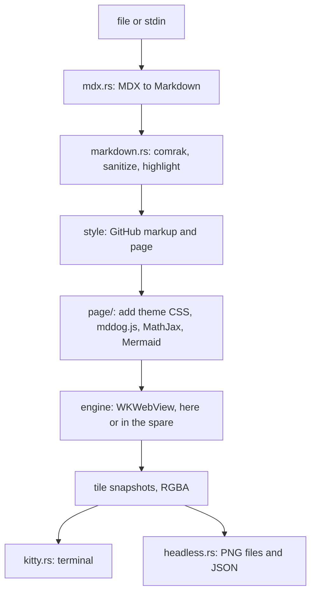
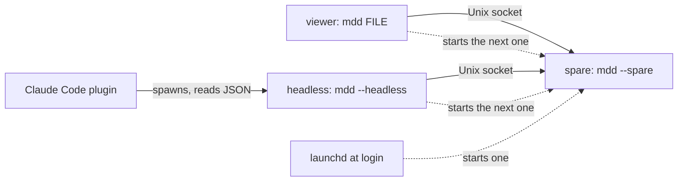
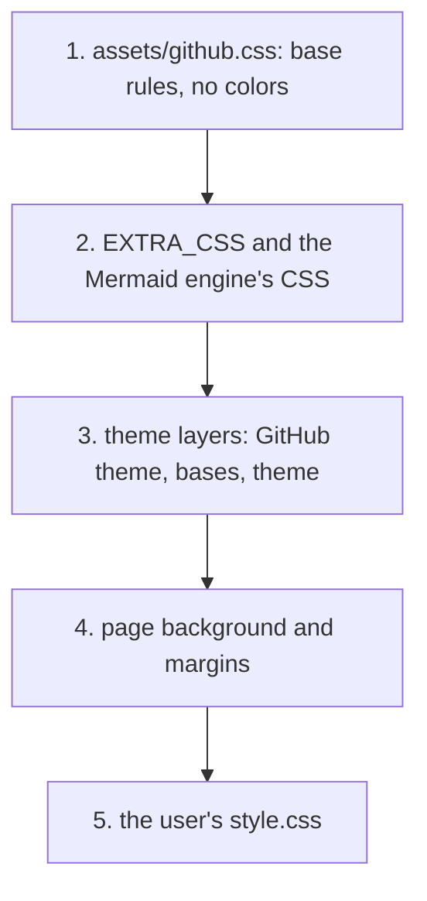
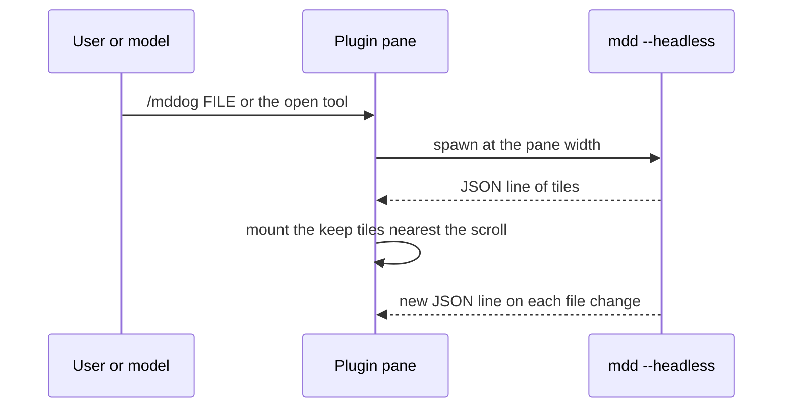

# Architecture

mddog shows a Markdown or MDX file in the terminal the way a browser shows it. It turns the file into an HTML page, lays the page out in an off-screen WebKit view, cuts it into image tiles, and draws the tiles with the Kitty graphics protocol. Keys and the mouse scroll, search, select, and follow links. The page reloads when the file changes.

It is a macOS-only Rust binary, `mdd`, with no library users. It runs in four ways:

| Mode | Started by | What it does |
|---|---|---|
| Viewer | `mdd FILE`, `mdd -`, or piped input | Draws the page in the terminal and handles keys and the mouse |
| File list | `mdd`, `mdd FOLDER`, or Ctrl-p in the viewer | Lists the Markdown files under a folder to pick from |
| Headless | `mdd --headless COLS FILE` | Writes PNG tiles and prints JSON, for the Claude Code plugin |
| Spare | the viewer, headless mode, or launchd at login (`mdd --spare`) | Waits with WebKit already started, so the next viewer starts fast |

Two parts decide how a page looks. The **style** is the HTML around the Markdown and the base CSS. There is one style: GitHub's repo view. The **theme** is one CSS file on top. It can only recolor the page, as `github-light` and `github-dark` do, or restyle all of it, as `obsidian-light` and `obsidian-dark` do. By default mddog uses the GitHub pair and follows the macOS appearance.

Related docs:

- [docs/behavior.md](docs/behavior.md): the contract for keys and events, with a test for each row.
- [docs/themes.md](docs/themes.md): how to write a theme.
- [docs/archive/](docs/archive/design-notes.md): measurements, spike findings, and rejected approaches.

## Project structure

```
src/
  lib.rs             crate root: exports render, the other modules are hidden and serve the binary
  main.rs            CLI: options, file and stdin checks, --spare, --start-at-login, --no-start-at-login
  config.rs          optional config file: theme, live reload, smooth scroll, glide time, copy on select, Mermaid engine
  theme.rs           themes: built-in list, mode and --mddog-* chrome colors read from a theme's CSS
  headless.rs        --headless: render to PNG files, for the Claude Code plugin
  watch.rs           file watcher
  editor.rs          runs $EDITOR
  trace.rs           test and debug logging
  assets.rs          extracts embedded runtime files to the cache
  sweep.rs           names and writes private temp files, and removes the temp files, sockets, and runtime folders that dead runs left behind
  render/            Markdown and MDX to HTML, the crate's only documented API
    markdown.rs      comrak to the HTML GitHub's Markdown API returns, then the style's markup
    mdx.rs           MDX to Markdown
    sanitize.rs, dom.rs  raw HTML allowlist, as a DOM pass
    highlight.rs     tree-sitter highlighting
    textmate.rs      TextMate highlighting (irosashi)
    emoji.rs, octicons.rs  :shortcodes: and inline icons
  page/              shared by the viewer, headless mode, and the spare
    mod.rs           reads the source, has the style build the page, writes it, and loads it
    script.rs        calls into mddog.js and parses its replies (layout, search, press)
    remote.rs        fetches remote images and media for the scheme handler and refuses private hosts, with its caches
  viewer/
    mod.rs           module list
    preview.rs       the viewer: first paint, event loop, mouse, links, selection, terminal writes
    cache.rs         tile ids, resident bytes, eviction, herdr bands, placements
    app.rs           key-to-action state machine (scroll, search, contents, history)
    chrome.rs        status row, contents sidebar, and the ? screen, drawn from App
    keys.rs          the key list shown on the ? screen
    loading.rs       the loading skeleton drawn in terminal cells
    picker.rs        the file list: walk, fuzzy filter, drawing, and keys
    position.rs      keeps the view on the same content across re-renders
    sizes.rs         each obsidian-engine diagram's drawn size, so the next skeleton opens at its height
  style/
    mod.rs           Style: markup, page, and default Mermaid engine; DEFAULT is GITHUB
    github.rs        the GitHub style: repo-view markup, page wrapper, base CSS, Mermaid CSS and scripts
  term/
    mod.rs           /dev/tty raw mode, terminal probe, key and mouse parser
    kitty.rs         Kitty graphics: transmit, place, free
  engine/
    mod.rs           Engine: a local WKWebView or a warm spare, 10 s call limit
    webview.rs       AppKit window and WKWebView
    spare.rs         warm spare process, socket protocol, launchd job
assets/
  github.css         the GitHub style's base CSS, from github-markdown-css and Primer CSS (both MIT), without colors
  themes/            built-in themes: github-light, github-dark (Primer's colors), obsidian-light, obsidian-dark
  mddog.js           in-page code: search, code scroll bars, mouse, selection, Mermaid
  runtime/           MathJax 3.2.0, mermaid 11.13.0, and Pele 1.6.0, embedded in the binary
  textmate/          128 grammars from starry-night, scope-to-class map
  spike.png, mddog-themes.png  README images
fixtures/            gfm.md, component.mdx and its GitHub twin, diagram.svg
tests/               integration tests (help over a pty, search, watch, headless, textmate golden)
reference/           Node and Python dev tools: CSS build, grammar export, captures, probes, e2e, bench
docs/                behavior spec, theme guide, terminal UAT notes, archive
plugins/
  claude-code/       Claude Code plugin: a pane that draws --headless output
```

## How a page gets drawn



1. `mdx.rs` turns MDX into Markdown. Plain Markdown skips this step.
2. `markdown.rs` writes the HTML GitHub's Markdown API returns, cleans raw HTML, and highlights code. The style then adds the repo view's markup.
3. `page/` wraps the article in a full page with the CSS layers and scripts, writes it to a temp file, and loads it in WebKit.
4. The engine lays the page out and takes snapshots, one tile at a time.
5. The viewer sends the tiles to the terminal. Headless mode writes them as PNG files instead.

The config file and `style.css` are read once at startup, before any of this.

### Processes



A viewer or headless run uses the spare's WebView when one is waiting, and its own WebView otherwise. A spare serves one client, then exits. See Warm spare.

### Threads in the viewer

The long-lived threads:

| Thread | Job |
|---|---|
| Main | Owns the tty writes, the engine, the `App` state, and the tiles. Blocks on one channel, and spins the WebKit run loop while it waits for a call. |
| Render worker | Reads the file and builds the HTML. It has a 64 MiB stack. |
| Input | Parses keys and mouse reports. |
| Signal | SIGWINCH becomes a resize. SIGTERM, SIGINT, and SIGHUP become a clean quit. |
| Watcher | notify's own thread. |
| Walker | Lists files for the file list while it is open. |
| Skeleton | Draws the loading skeleton until the first tiles go out. |

Short side threads also pipe copies to `pbcopy`, read the macOS appearance at startup, run the sweep, and fetch each remote image (see Remote images).

Input, signals, and the watcher all feed one channel. The main thread reads it and passes each event to `app.rs`, which returns actions.

A SIGINT that arrives while the editor runs is ignored. The signal handler checks whether the viewer was paused when the signal arrived, because the same Ctrl-C ends the editor, and by the time the signal thread runs the viewer may have its screen back.

## Startup and config

### CLI

`main.rs` checks the file before it takes the terminal, so a typo, a binary, or a URL gets a plain error.

- With no file and a terminal on standard input, or with a folder, it opens the file list.
- With `-`, or with no file and piped input, it copies standard input to a private temp file.
- `--help` is short and points to the `?` screen for keys. It works even when the config file is broken, because `main` loads the config only after it parses the options.
- `--headless COLS FILE` runs headless mode. Like the viewer, it stops on a broken config.
- The viewer refuses to start in a terminal that has no Kitty graphics, and in Warp and zellij, which garble a scrolled image.

### Config

`src/config.rs` reads the optional config file, `$XDG_CONFIG_HOME/mddog/config.toml`, else `~/.config/mddog/config.toml`, plus an optional `style.css` in the same folder. `config.example.toml` lists every key.

| Key | Default | Effect |
|---|---|---|
| `theme` | `light:github-light,dark:github-dark` | One theme, or one per macOS appearance. A theme is a built-in name or a `.css` path. |
| `live_reload` | `true` | Reload when the file changes. |
| `smooth_scroll` | `true` | Jump keys glide. `false` makes every jump instant. |
| `glide_ms_per_page` | `200` | How long a glide over one screen takes. |
| `copy_on_select` | `false` | Copy a selection when the mouse button is released. |
| `mermaid.engine` | unset | `pele` or `obsidian`. Unset, the theme picks. |

`main` loads the file once, before the viewer takes the terminal, into a `OnceLock`. Everything else calls `config::get()`, which returns the defaults when nothing was loaded (tests, the library).

Unknown keys and bad values stop the run with one line that names the file, the line, and the dotted key. `parse` also reads the theme files, so a missing file or a bad theme stops the run the same way. The spare loads the config too, for its warm-up page, and ignores errors there.

## Page look: style and theme

### The style

A `Style` in `src/style/mod.rs` holds what the theme's CSS can't change:

- `dress` adds the style's markup to the sanitized HTML.
- `page` wraps the article in a full page with the style's CSS and scripts.
- `mermaid` is the Mermaid engine when neither the config nor the theme names one.

The goal is to show a Markdown file the way a browser or a Markdown app would. GitHub's look is the default, not the goal. `style::DEFAULT` is `GITHUB`, the only style. It adds what github.com's repo view has after its scripts ran: heading anchors, front matter tables, the copy-button boxes around code, the Mermaid container, and the repo view's wrapper elements (`CHAIN`) that github.com's CSS selects on.

Other parts depend on GitHub's class names too: `mddog.js` (copy buttons, code scroll bars, Mermaid), the `pl-*` highlight classes, `highlight::copy_box`, and `EXTRA_CSS`. A second style would keep those names or bring its own versions.

### Themes

A theme (`src/theme.rs`) is one CSS file. The built-ins are `assets/themes/*.css`, embedded in the binary and listed in `BUILTIN`, one line each. A new built-in is that line and its file.

| Theme | Changes | Mermaid engine |
|---|---|---|
| `github-light`, `github-dark` | Primer's color variables only | pele |
| `obsidian-light`, `obsidian-dark` | Obsidian's reading view: fonts, headings, links, lists, task lists, quotes and callouts, code, tables, images, footnotes, and colors | obsidian |

The Obsidian themes still sit on the GitHub style's markup and base CSS. The two Obsidian files differ only in their `:root` colors. A test checks that the rules after that block match.

**Reading a theme.** `theme::parse` (built-ins) and `theme::file` (theme files) read the top-level `:root` rules of the theme. They skip rules inside `@media` and nested rules. From those rules they take `--mddog-base`, `color-scheme` (light or dark), `--mddog-mermaid`, and the eight `--mddog-*` hex colors into a `Palette`. `masks` blanks comments to spaces and string contents to `x` at the same byte offsets, so a quoted `{`, `}`, `;`, or `/*` can't move a rule's edges. The scan takes only literal hex, so it doesn't need a CSS parser.

**Bases.** A theme with `--mddog-base` keeps its base (a built-in, or a file relative to its own folder) in `Theme::base`. `theme::file` loads the chain and stops on a file it has already seen, by canonical path. A theme with no mode takes its base's mode, and a different `color-scheme` is an error. A color the theme leaves out comes from its base, else from `github-light` or `github-dark`, by mode.

**Relative URLs.** The page's `<base>` is the Markdown file's folder. So `theme::relative_urls` rewrites each relative `url()` and `@import` in a theme file to `file://<that file's folder>/<target>`. It leaves any `scheme:`, `#`, and `/` target alone. The config does the same for `style.css`, against the config folder. Built-ins have no relative URLs.

**Light and dark.** `config::theme()` returns the theme to draw with: the one theme, or for a `light:...,dark:...` pair the one for the macOS `AppleInterfaceStyle` setting, read each time a page is built. `Engine::load_file(path, theme.dark)` sets the view's NSAppearance (Aqua or DarkAqua) before each load. The page keeps `data-color-mode="auto"`, so the CSS's `prefers-color-scheme` rules, `<picture>` sources, and `gh-dark-mode-only` links follow the appearance.

There is no appearance observer. A change shows on the next reload, resize, wrap toggle, return from the editor, or when help opens. Help draws in the page's colors, so `?` reloads the page first when `config::theme()` changed. The spare builds its warm-up page in the config's theme, and its `load` request carries the mode.

### CSS layers

The GitHub style puts CSS into the page's `<head>` in this order. Each layer can override the ones before it, except that layer 4 uses `!important`, so a theme or a plain `style.css` rule can't change it.



| # | Layer | Source |
|---|---|---|
| 1 | github-markdown-css's Markdown rules and the Primer CSS rules around them (buttons, tooltips, utilities), without colors, then `reference/github-overrides.css` | `assets/github.css`, built by `reference/build-css.mjs` |
| 2 | mddog's own rules, written against GitHub's variables. On pages with diagrams, the engine's rules: `MERMAID_CSS` for pele, or `SKELETON_CSS`, `OBSIDIAN_CSS`, and in dark themes `OBSIDIAN_DARK_CSS` for obsidian | `EXTRA_CSS` and the rest in `style/github.rs` |
| 3 | One `<style>` per theme layer, from `Theme::layers`: the GitHub theme of the theme's mode (unless the chain starts there), each base from the bottom up, then the theme | `theme_layers` in `style/github.rs` |
| 4 | The page background (the theme's `--mddog-bg`, which Pele also uses) and fixed margins, padding, and width | inline in `github::page` |
| 5 | The user's `style.css`. A `:root` rule here beats the theme's by order, with no `!important` | config folder |

So a partial theme keeps its base's or GitHub's colors for what it leaves out, as the `--mddog-*` fallback does for the terminal chrome. A GitHub theme is one layer. The GitHub themes set Primer's color variables on `:root`, and no rule in the base CSS sets them, so moving them from GitHub's mode selectors to `:root` kept every render the same byte for byte.

### Terminal chrome colors

The terminal parts draw with the theme's `Palette`: the file list, the status bar, the contents sidebar, the `?` screen, the screen clears in `Preview::show`, and the loading skeleton. `Palette::reset()` is `\x1b[0m` plus the background. Every drawer uses it in place of a plain `\x1b[0m`, so the cells between spans keep the theme's background. `theme.rs` holds the only SGR color formatters. The file list has no page, so it calls `config::theme()` at each draw.

## Rendering

### HTML pipeline

**MDX.** markdown-rs parses the file. Imports, exports, expressions, and comments are dropped. Each component (a JSX element whose name is not lowercase HTML) becomes a `jsx` code block of its source. Lowercase elements such as `<details>` stay as HTML and go through the sanitizer. Nothing is executed. On a parse error the file renders as plain Markdown.

**Markdown.** `markdown.rs` parses with comrak (GFM on) and writes the HTML GitHub's Markdown API returns: alerts, footnotes, task lists, and math and Mermaid blocks.

1. `sanitize.rs` cleans raw HTML with GitHub's allowlist.
2. `markdown.rs` notes whether the page has math or Mermaid, then calls the style's `dress`.
3. Last, it links raw URLs and keeps source positions on top-level blocks only.

Two cmark quirks need care. cmark drops a backslash before punctuation and reads `*` and `_` in math as emphasis, so math is escaped before parsing. cmark also turns `\$` into `$`, so an escaped dollar outside code is held as `HELD_DOLLAR` until the math pass. Local media is confined to a root folder (see Security).

**Code.** Code is highlighted the way GitHub does it, with GitHub's `pl-*` classes. tree-sitter covers JS, TS, TSX, Python, Rust, Go, Ruby, CSS, HTML, and PHP. irosashi, a Rust port of vscode-textmate, covers the rest with starry-night's grammars. `tests/textmate.golden` pins the output.

**Page.** `page/` (`page::doc`, `page::html`, `page::load`) is the one path from file bytes to a loaded page. The viewer, headless mode, and the spare all use it.

- It hands the article to the style's `page`, which adds the CSS layers, `mddog.js` and MathJax from `page::scripts`, and the Mermaid scripts.
- `page::load` writes the page, waits for the load event, then gives fonts and images up to 500 ms.
- If the load event never comes, it returns an error. The viewer keeps the source, shows `The page did not load`, and tries again on the next re-render.
- The runtime files are extracted once to `~/Library/Caches/mddog/runtime-<hash>/`. `build.rs` computes the hash.
- WebKit's fallback draws the footnote back-link `↩` from a text font, where Chrome uses Apple Color Emoji, so `EXTRA_CSS` forces the emoji font.

### Mermaid

`page::Opts.engine` picks the engine, from `config::mermaid(theme)`: `mermaid.engine` if set, else the theme's `--mddog-mermaid` (inherited from its base), else the style's default, pele. Both engines are always embedded under `assets/runtime/`. The style's `dress` puts an engine-neutral `mddog-mermaid` element inside GitHub's diagram box, with its copy and expand buttons.

| | pele | obsidian |
|---|---|---|
| Library | [Pele](https://pele.run) 1.6.0 (MIT) | mermaid 11.13.0 from npm (MIT), with Obsidian 1.14's settings |
| Used by | GitHub themes | Obsidian themes |
| Where it draws | SVG in the page, no iframe | a hidden `srcdoc` frame, then an `` in the page |
| When | before the page finishes loading, so in the first paint | after the first paint, with a skeleton until then |
| Frame and buttons | GitHub's box, copy and expand buttons, zoom buttons only on a diagram it shrank | none, left-aligned at its own size |
| Colors | `MERMAID_CSS` maps them to the theme's Primer variables | mermaid's `default` theme, inverted in dark themes |
| Images in a diagram | left out (`images: false`) | blocked by the frame's CSP |

Pele uses its own layout, so its diagrams differ from GitHub's.

**The obsidian engine** does what Obsidian's reading view does. Obsidian doesn't theme its diagrams. It runs plain mermaid with the `default` theme in both modes and inlines the SVG. In dark mode it adds `filter: invert(100%) hue-rotate(180deg) saturate(1.25)`. mddog ships the same mermaid from npm (not Obsidian's copy) and calls it with Obsidian's settings: `securityLevel` strict, `themeVariables.fontFamily` the page's text font, `useMaxWidth` false for flowchart, sequence, git, and ER diagrams, and true for gantt, journey, class, state, and pie.

1. At DOMContentLoaded, `renderObsidian` in `mddog.js` puts a skeleton over each 200 px box.
2. `mddog.startMermaid()` (`script::START_MERMAID`) adds a hidden `srcdoc` frame at the page width that loads mermaid, so its 3 MB stays out of the first paint. It renders each diagram there, with 4 s for each. A call that comes before the frame is set up is kept and runs once setup ends.
3. When every diagram is done, all the images and error boxes replace their skeletons at once, and the frame is removed. `MERMAID_DONE` turns true once the images are decoded, so a snapshot after that has them. The live layout changes once, not once per diagram.
4. 45 s after `startMermaid`, whatever hasn't drawn shows an error. So the page settles before the viewer's 60 s `LATE_LIMIT`, and no late diagram changes the layout after the last re-send.

Every page load with Mermaid sends `startMermaid` before it waits on `MERMAID_DONE`: `Preview::render_doc` after `show()` on the first paint and every reload while `MERMAID_DONE` is still pending, headless mode and the spare's warm-up right away, and the `load_page` test helper. Pele ignores the call.

A diagram can name images (an image shape, an `` in a label), and an in-page render would fetch them past mddog's media checks. So the frame's CSP allows only `data:` images and fonts, and each SVG shows as an `` with a `data:` URL, which doesn't load anything either. A diagram whose image is blocked shows mermaid's loading error. Diagram text can't be selected or searched. If mermaid fails to load, each box shows an error.

`OBSIDIAN_CSS` left-aligns the diagram and hides GitHub's diagram buttons. `OBSIDIAN_DARK_CSS` adds the filter when the theme is dark. A width change doesn't need a reload: a diagram at its own size keeps it, and one that fits the width scales with CSS.

**Skeleton heights.** The skeleton opens at the diagram's drawn height when mddog has seen that diagram before.

- On reveal, `mddog.js` stores each diagram's viewBox in `state.sizes`, keyed by an FNV-1a hash of the source (`key`). A diagram drawn at its own size is stored with width 0, so its guess isn't scaled down.
- When the late check settles, `tick` merges those into `Sizes` (`viewer/sizes.rs`).
- After `READY`, `render_doc` passes them to `mddog.guess`, which sets each known box to that height at the current width.
- The sizes live in memory for reloads and in a cache file for reopens.
- The reveal clears the guessed height before it applies the real one, so the settled page doesn't depend on the guess. Only the viewer guesses, not headless mode.

### Engine

The engine is a WKWebView in a borderless window parked off-screen, at the pane's CSS width and the display's scale. Each load sets its appearance to the theme's mode.

- The window is ordered in with occlusion detection off, because WebKit gives a hidden window almost no rendering updates.
- Every call has a 10 s limit. After one stall every later call fails at once, so `q` still restores the terminal.
- WebKit snaps a snapshot rect that starts or ends between CSS pixels, which shifts its rows by a device pixel and changes how text rasterizes. With an odd cell height at scale 2, every other tile starts on a half CSS pixel. So `snapshot_into` takes the whole CSS pixels around such a rect and keeps the rows it was asked for.
- WebKit spends a few ms on the first full layout after the load event, before it answers the next call. `measure` would force that layout anyway.

### Warm spare

A cold first paint takes about 200 ms, most of it AppKit and WebKit startup. A warm one takes about 40 ms. So the viewer (after its first paint) and headless mode start `mdd --spare`, which loads a warm page and waits on a Unix socket for the next viewer.

**Finding the spare.**

- The socket is in the per-user temp dir. Its name hashes the binary's path, size, and mtime, so a rebuilt binary never reaches an old spare.
- The viewer connects only to a socket its own user owns, and each side talks only to a peer with its own uid (`getpeereid`). The spare ignores a connection that never sends hello.

**Protocol.** The viewer drives the spare's WebView with six requests: `eval`, `load`, `resize`, `wait`, `snap`, and `render`. `load` carries the theme's mode as its third element. `render` is `["render", src, dir]`, so the spare confines media to the same root. A late or missing reply to the first render ends the connection, so the spare can't answer the main thread's next request with a stale reply.

**Warm-up.** The spare warms a file page, math, and Mermaid before a viewer asks, since the first of each costs more. One thread with the viewer's 64 MiB stack builds every highlighter (they are cached per thread) and does every render. Snapshots go straight into the shared memory the tile is sent in.

**Lifetime.**

- A spare serves one viewer, then exits. An unused spare exits after 12 hours.
- It forks once more and the middle process exits, so launchd adopts it. Claude Code kills the plugin's child and all its descendants on each width change, and the next child would otherwise use a dying spare.
- `--start-at-login` adds a launchd job that starts one spare at login. The job has no `KeepAlive`, so after that first spare the viewers start their own. `--no-start-at-login` stops and removes the job.
- `MDDOG_NO_SPARE` turns the spare off.

## Drawing in the terminal

### Tiles

Tiles are pane-wide, a whole number of cell rows tall, and at most 8 MiB and 10,000 px tall each.

**Transfer.** The startup probe picks the route: shared memory, then a temp file under `$TMPDIR`, then PNG chunks. PNG is the only route over SSH, where it makes a tile about 30 times smaller. macOS limits shm names to 31 characters.

**Pixels.** WebKit snapshots are premultiplied sRGB BGRA, so converting them to RGBA is a channel swap straight into a zeroed shm buffer, whose size rounds up to whole pages. Any other pixel format falls back to a Core Graphics draw.

**Placement.** Each visible tile gets one placement with a source rect. Scrolling moves the source rect inside a synchronized update. A tile that scrolls out loses its placement by placement id (`a=d,d=i,i=<id>,p=1`), because iTerm2 frees the image itself on a `d=i` without `p`, and the tile then comes back blank.

Each tile is sent with one extra cell row below it, a copy of the next tile's first row (the last tile has none), for glides. A tile plus its extra row stays under both size limits.

**Storage limit.** mddog keeps the tile bytes the terminal holds under a limit:

| Terminal | Limit | Why |
|---|---|---|
| herdr (XTVERSION starts with `libghostty`, or `TERM_PROGRAM=herdr`) | 56 MiB | herdr's quota is 64 MiB |
| anything else | 300 MiB | other terminals hold about 320 MB |

Past the limit, the tiles farthest from the view are freed and re-sent when needed. Visible tiles are never freed. So a view larger than the limit on its own (a full-screen pane on a 5K display under herdr) goes over it, and herdr then drops the oldest images.

**Re-tile.** After a re-tile resizes the WebView, a snapshot taken before the page has its new size comes back blank. `retile` polls `innerHeight` until it shows the new size, and falls back to waiting for a frame if the poll passes 100 ms.

### Bands under herdr

herdr copies every image, and its client sends it on to Ghostty as base64, so re-sending an 8 MiB tile is expensive. So under herdr (the same check as the storage limit), a selection or search change does not re-send the tiles it touches. Instead, the changed rows, snapped to whole cells and full pane width, go out as a **band** image placed over the tile at `z=1`.

- `viewer/cache.rs` owns tile ids, the resident byte count, eviction, bands, and placements. `Preview` writes what it returns to the terminal and passes it a snapshot closure, so its tests use a fake. Every subtraction from the resident count uses bytes that `Tile::release` or a band added before.
- A tile keeps its bands in `Tile::bands`. A new change that touches a band replaces it with one band over both (`join_bands`). The tile's byte count includes its bands.
- Bands are placed with the tile on every frame, cropped to the view, so they move with it on scroll. `Tile::release` frees a tile and its bands together.
- A tile goes out whole again, which removes its bands, when it would hold more than 4 bands or bands over half its rows, when it changes while out of view, 1 s after the last input, or when it is re-sent anyway (reload, resize, eviction, help).
- For a drag, `Preview::selection_js` counts only the rects that differ between the old and the new selection, so a long drag sends only the rows at its moving end.

### Glides

A glide (see Keys and scrolling) draws the view at any pixel offset, not only on cell rows. But a placement can't start or end between cell rows exactly. Ghostty draws a placement `r * cell_h - Y` pixels tall from the cell top plus `Y`, and herdr 0.9.5 rewrites `c` and `r` from its own grid as `ceil((h + Y) / cell_h)`. So under herdr, a piece whose bottom falls between rows is stretched. Instead, every placement starts and ends on a screen row:

- Screen row `r` shows the page from `scroll_px + r * cell_h`. `cache::rows` gives the rows each image draws.
- A tile draws the rows that start inside it. The last of those can cross into the next tile, and the tile's extra row covers that part.
- A band is sent with one extra row above and below (`Band::src`), and draws every row it touches.
- So each placement's source height is `rows * cell_h`, with no `Y=` and no rescale, and `kitty::place` is the same as for whole-row scrolling. At a whole-row offset the placements are the same as before glides existed.
- A change in a tile's extra row also re-sends that tile, or under herdr gives it a band.

### First paint

The main thread probes the terminal while the worker renders and WebKit starts. The probe sends CSI 16 t, XTVERSION, DECRQM for modes 2026 and 1016, a Kitty `a=q` query, then DA1, and waits up to 1 s.

- The first snapshot covers only the first viewport. The other tiles follow in idle time.
- Math gets up to 1 s.
- Pele draws its diagrams before the page finishes loading, so they are in the first paint. Obsidian-engine diagrams are not waited for (see Mermaid). The late re-send shows them once the last one is drawn.
- Remote images are not waited for (see Remote images). The page draws each as a muted box, and the late re-send shows the image.
- `Engine::new` starts compiling the content rule (see Security). WebKit compiles it off the main thread, and it is in place within 1 ms of the page file being written, well before the load ends. Only the spare waits for it, before it serves. It compiles on every run, since that doesn't cost anything measurable.
- Anything that finishes late is measured again, with the position kept.

A side thread reads the macOS appearance at startup, because the first `config::theme()` call for a theme pair sets up NSUserDefaults, which is slow.

### Remote images

`markdown::render_in` moves every remote `src`, `srcset`, `poster`, and video `src` into a `data-mddog-*` attribute, so the first paint never waits on the network. After the first paint, `remote::load` calls `mddog.loadRemote`, which sets each URL back with `mddog-` in front: `https://x/a.png` becomes `mddog-https://x/a.png`. Those two schemes go to `RemoteHandler`, a `WKURLSchemeHandler` that `webview::Engine::new` registers, so the viewer, the spare, and headless mode all have it. WebKit itself never fetches a remote image (see Security).

- Each request gets its own thread, which calls `remote::fetch` with ureq. A host gets at most 6 at once.
- The thread sends each result to the main queue (`dispatch2`), which runs while the main thread spins the run loop. A task WebKit stopped leaves `TASKS` on the main thread, and later results for it are dropped, because WebKit throws on any call to a stopped task.
- Only `image/*`, `video/*`, `audio/*`, and octet-stream bodies are passed on, up to 32 MiB, within 30 s.
- A video reads its metadata through about 150 small range requests. The first one fetches a 2 MiB block, and the rest are answered from it, so metadata takes about 0.5 s instead of 2.6 s.
- Responses stay in memory (64 MiB) and whole ones on disk (see Data and files) for their `max-age`, between 1 minute and 1 hour, else 5 minutes. A live reload re-requests every image on each save, so even `max-age=0` is kept a minute. `no-store` is not kept.
- An image that fails becomes a dashed box with its alt text, and `blocked` or `failed`. The page learns which with a `HEAD` to the same URL, which the handler answers from the last outcome: 403 for blocked.
- The viewer gives each image 15 s, under the 60 s late limit. Headless mode gives 4 s, under its 5 s wait, so a slow image is drawn as failed rather than as a box. It waits rather than rendering again when images arrive, because each render writes every tile again and the plugin redraws them all.
- `MDDOG_TRACE` logs `remote done`, `failed`, or `blocked` for each fetch, with its time.

On a 10-image document (medians of 8 runs, with the disk cache filled after the first run):

| | Before (WebKit fetched) | After |
|---|---|---|
| Viewer cold, first paint | 206 ms | 207 ms |
| Viewer cold, time to images | 672 ms | 297 ms |
| Viewer warm, first paint | 30 ms | 30 ms |
| Viewer warm, time to images | 276 ms | 152 ms |
| Headless cold, tiles written | 413 ms | 412 ms |

Without the disk cache, time to images was 470 ms cold and 286 ms warm. ureq with native TLS adds about 0.5 MB to the release binary (26.9 to 27.4 MB).

### Loading skeleton

While a file loads, `Loader` (`loading.rs`) draws a page-shaped skeleton in terminal cells: a heading bar, text lines, and a code block, with a diagonal shimmer that moves every 100 ms.

- It draws only when the page is not ready after 100 ms (`DELAY`), so a warm start usually finishes before it shows.
- Once drawn, it stays at least 100 ms (`MIN_SHOWN`), so it never flashes.
- The margins are the page's 24 CSS px padding times the screen scale, over the cell size. The colors come from the theme.
- `Loader::tune` takes the probe's answers. A resize redraws the frame in full.
- `show()` calls `finish()` after the tile snapshots, so the minimum wait overlaps that work, and the clear and the first tiles go out in one synchronized update.
- The `term::WRITE` lock covers each whole write from `Tty::write` and the loader, so a frame can't split the probe query.
- Opening a file from the file list, or going back to the file before, starts a new `Loader` before the file is parsed. Its first frame clears the screen, so it replaces the list. The file list itself has no skeleton.

## Interaction

### Keys and scrolling

`app.rs` is pure. It turns a key or mouse event into actions and holds no terminal or WebKit state, so it is unit tested row by row against [docs/behavior.md](docs/behavior.md). `chrome.rs` draws the status row, the sidebar, and the `?` screen from `App`, so they are tested without a terminal too. `preview.rs` carries out the actions.

**Resize.** Resizes are debounced by 120 ms. A resize or contents toggle reuses the rendered HTML (`Preview::doc`) when the file bytes still match. A resize lays the live page out again instead of loading it (`Preview::resize_in_place`): it resizes the WebView, waits until `innerWidth` shows the new width, measures, and scrolls to the same content anchor a reload uses. A page with diagrams also waits for one rendering update, because Pele refits its SVGs in a ResizeObserver callback that runs after the measure would. The resize falls back to a full reload when the result could differ from a fresh load:

- The file changed (with live reload on), or the macOS appearance changed under a theme pair.
- A click changed the DOM (a copy, a `<details>` toggle, a button), text is selected, or a diagram is expanded.
- The page has `<picture>` or `img[srcset]`, which can pick a new source by width.
- The page did not reach its new size, or the frame did not come, within 100 ms. The old geometry is restored first, so the reload keeps the position.

**Glides.** The jump keys glide: `d`/`u`, `f`/`b`, Space, PageUp/PageDown, `g`/`G`, Home/End, Backspace/Ctrl-o, digits, `J`/`K`, `]]`/`[[`. `App::handle` turns their `Action::Scroll` into `Action::Glide`. The keys in `App::instant` (`j`, `k`, `n`, `N`, Enter, the wheel) move at once. `App.scroll` takes the target at once, so the status row and sidebar show where the view is going. Only the drawn offset moves.

- `app::Glide` eases out (cubic) from where the view was drawn to the target. It is time-based, so a late frame skips ahead and the glide still ends on time. It covers at most one screen, so `G` from the top glides only the last screen. A jump during a glide starts a new one from the drawn offset, and may cover one screen more than the old glide had left, so quick repeated presses never skip.
- `app::Pace` sets the time. A glide over one screen takes `glide_ms_per_page`, and a shorter one takes its share. A jump key within 100 ms (`REPEAT`) of the last one glides in 50 ms (`FAST_GLIDE`), like snacks.nvim's `animate_repeat`. Holding `f` keeps the view 1.4 to 1.9 screens behind the target, with no frame moving more than one screen.
- `Preview` holds the running glide, `drawn` (the offset `show` last drew, where a new glide starts), `path` (the tiles a new glide passes over), and `last_jump`. `shown_px()` feeds `view()`, `grid()`, and `view_css()`, so drawing and mouse hits use the drawn offset, while `scroll_px()` stays the target everywhere else.
- `start_glide` jumps instead when `smooth_scroll` is off, the terminal lacks mode 2026, or the path's tiles don't fit in the storage limit together (`Cache::fits`, bands included). The first `show()` sends the path's missing tiles inside its synchronized update and keeps them from eviction. Then it restarts the glide clock, so a slow send doesn't shorten the glide.
- While a glide runs, the event loop wakes every 8 ms and `tick()` advances it, skipping frames that land on the same pixel. Prefetch pauses.
- `settle()`, `Action::Scroll`, `Action::Search`, a resize, an instant key, a mouse press, help, and the file list end a glide. A press ends it before it is handled, so the press and its release hit the same page point. `show()` uses `path` only while a glide runs, so a glide that ended before its first frame doesn't leave stale tile indices behind.
- The trace's `view` line starts with `px=` (the drawn offset) and `took=` (ms in `show()`).

**Pixel mouse.** When the probe finds mode 1016, the terminal reports the mouse in pixels, not cells. `Preview::spot` turns each report into its cell plus where it falls inside that cell. So the status row, the sidebar, and double clicks still work in cells, while links, word selection, and code scroll bars are hit at the exact point. Without 1016 the point is the cell's center.

**Kitty keyboard.** The viewer pushes kitty keyboard flag 1 (`term::KEYS_ON`, `ESC[>1u`) after it enters the alternate screen, and pops it (`term::KEYS_OFF`) before it leaves, in `term::leave()` and `Preview::leave_screen`, since each screen keeps its own flag stack. Flag 1 is the only flag that makes the terminal send Cmd-c (`CSI 99;9u`). It also turns Ctrl-letters and Esc into CSI-u forms, so `term::csi_u` maps those back to the `Key` their legacy bytes give, and the rest of the viewer doesn't see a difference. The one new key is `Key::Copy`, which `App` turns into `Action::CopySelection` in every mode. There is no `CSI ? u` probe: a terminal that ignores the push keeps sending legacy bytes, which parse as before.

**Contents scroll bar.** When the contents list overflows, the sidebar's last `app::TOC_BAR` (3) columns hold its scroll bar: a thin line on each side and a thin thumb between them. A list that fits keeps one separator column. `App::toc_thumb()` gives the thumb's top and length, and both `Chrome::sidebar` and the hit tests (`App::toc_bar_press`, `toc_bar_drag`) use it, so what is drawn and what is hit agree. `App::toc_grab` holds the thumb row the pointer grabbed. `preview.rs` only routes by column: a list-row press within 3 columns of the sidebar's edge goes to the bar, and the wheel at `col <= img_col` scrolls the list. `Key::WheelUp` and `Key::WheelDown` carry their cell for this.

### File list

`picker.rs` holds the list. `Picker` keeps the items, the filter, and the selection, and `draw` paints the list over the whole screen as terminal text, as the `?` screen does. `preview::browse(root)` starts with the list and no document. It draws the list right after raw mode, before WebKit starts and before the terminal probe, and waits up to 50 ms for the first batch. Ctrl-p (`Action::Browse`) opens the same list over a file and keeps the last filter.

- **Root.** `scope` picks the nearest folder with `.git` above the start, else the current folder. `mdd` starts from the current folder, and Ctrl-p from the open file's folder (the current folder for standard input). A folder argument is the root itself. Each Ctrl-p calls `Picker::follow`: when the open file is outside the current root, the root becomes `scope` of the file's folder, and the filter is cleared. A file under the root keeps it, so a list of a plain folder, or of a folder that holds several repos, stays put.
- **Walk.** A walker thread uses `ignore::WalkBuilder` with `require_git(false)`, so it skips hidden and gitignored files with or without git. It keeps `.md`, `.markdown`, and `.mdx` files and stops at 10,000 (`CAP`), in walk order. It sends a batch every 30 ms with `term::Event::Listed`, which wakes the event loop. An `AtomicBool` stops the walk when the list closes or restarts.
- **Titles.** `title` reads the first ATX heading from each file's first 4 KiB. Setext headings and headings after long front matter don't give a title.
- **Filter.** `nucleo-matcher` scores `path + " " + title` as one string. `Picker` splits the match positions back into the path and the title for highlighting. The filter takes fzf's syntax (`!`, `^`, `'`, `$`).
- **Switching files.** `open`, `switch`, and `back_file` change files inside one `Preview`. `open` pushes a `Visit`: the file, the stdin flag, the name, the whole `App`, a position anchor, and the source. The history holds 50 (`HISTORY`). `switch` resets the document state, restarts the watcher, and calls `render_doc`, which maps `restore_at` through a line diff as a reload does. The new `App` keeps `wrap` and `toc_visible`.
- **Back.** Backspace and Ctrl-o first go back through jumps in the current file. With none left, `App` emits `Action::BackFile`, and `back_file` returns to the file before at its old position. A file that can't be read is dropped from the history, so older files stay reachable.
- When the list is up, `show()` frees the tiles and draws it, and `draw_chrome` and `prefetch_target` skip. Opening a file renders it on the main thread, as a reload does.

### Position keeping

Every top-level block carries comrak's `data-sourcepos`. Before a re-render, mddog records the source line at the top of the view and the offset into its block. Afterwards it maps that line through a line diff of the two sources (`similar`) and scrolls back to the same spot.

### Search

`mddog.js` finds every occurrence across inline elements and soft wraps, with smart case (any uppercase letter makes it case-sensitive). It highlights them with the CSS Custom Highlight API, so the layout does not change.

- Only the tiles whose highlights changed are snapshotted and sent again. Under herdr only the changed rows go out, as a band.
- Each match's client rects are measured once, and measured again only when the current match sits in a sideways-scrollable block that `reveal` may have moved. Most of the cost is WebKit's `Range.getClientRects`.
- A search snapshot still waits for a frame: CSS highlights paint only during a rendering update, and `afterScreenUpdates` alone does not include them.

### Wide code blocks

mddog clips the page root and shows images, so it scrolls each `pre` itself. The page draws its own scroll bars (`mddog-hbar`), because WebKit paints none in a snapshot. Shift + wheel, `h`/`l`, and dragging a bar change `scrollLeft`, and only the affected tiles are sent again. `w` toggles wrapping for all code blocks.

### Mouse, links, and selection

Clicks map from cells to page CSS pixels. On release, mddog tries a link (`link()`), then a button (`press()`). Links open with `open`, or jump to a heading. Drag and double-click select text and paint the highlight. Releasing copies nothing unless `copy_on_select` is on.

**Copy buttons.** `highlight::copy_box` wraps every code block in the repo view's box, with the copy button beside the `pre`. The GitHub style shows it at all times. A click copies the button's `value`. Mermaid diagrams have their own copy button.

**Copying.** Every copy goes through `Preview::copy_text`.

1. It strips control characters (`pasteable`).
2. It writes OSC 52 to the tty, so the copy reaches the clipboard of the terminal the user sits at (also over SSH, and through herdr, which shows its own notice). The write runs on the main thread between frames, so it never splits a tile write. It has no size cap: Ghostty under herdr drops one over about 220 KB, and `pbcopy` still covers the local clipboard.
3. It pipes the text to `pbcopy` on a thread.

`Preview::copy_selection` copies the page's DOM selection, for Cmd-c and for a release when `copy_on_select` is on.

**Hover.** Mode 1003 reports moves with no button held (`Click::Move`). Off-screen WebKit never gets a real pointer, so `:hover` never fires, and mddog does hover itself.

- `Preview::hover` hit-tests a move only when it reaches a new spot (`hover_at`: the spot plus the drawn offset), through `mddogMouse.hover(x, y)`. That returns the pointer shape and the boxes to redraw.
- Only code-block copy buttons (`.zeroclipboard-container clipboard-copy`) get the hover look. The page sets `mddog-hover` and GitHub's `tooltipped` classes itself, and the tooltip text is the `aria-label`, so `Copied!` wins while it shows. Mermaid buttons get only the hand.
- `hover(x, y, slack)` also gives the hand over code scroll bars, through `mddogCode.bar`, the same hit area a press grabs.
- The event loop keeps only the last of a run of queued moves. Any other event marks `hover_at` stale, and the loop hit-tests again once no drag is held. So a scroll, help, a relayout, or a new page updates hover under a still pointer.

**Pointer shape.** `set_pointer` sends OSC 22 only when the shape changes: `xterm` over text, the hand over links and controls, `left_ptr` elsewhere. The hand is `Probe::hand()`: `hand2` for iTerm2, which knows only X11 names, and the W3C `pointer` for the rest, since Ghostty has no `hand2`. kitty takes both. `MOUSE_OFF` ends with an empty OSC 22, so every way out of the screen resets it. herdr and WezTerm drop OSC 22. herdr parses it and never forwards it, and its maintainers closed the request to add that (herdrdev/herdr#5279), so mddog doesn't work around it.

**Expand.** The obsidian engine hides the diagram buttons, so only Pele diagrams expand. A diagram's expand button makes `press()` return `expand`. `mddogMouse.expand` then copies Pele's drawn SVG into an `mddog-expanded` overlay over the visible rows, scaled to fit. `App::expanded` makes the next key or click call `collapse()`. A new page load clears it.

**Task checkboxes.** The viewer is read-only, so a click on a task box does what a click on plain text does.

- The box is drawn with CSS (`appearance: none` in `EXTRA_CSS`), in the gray Chrome draws for github.com's disabled boxes, sampled in each GitHub theme. WebKit's native box is nearly black in a window that is never key. The Obsidian themes draw their own box.
- Raw HTML can't write its own source positions: every `data-sourcepos` in it becomes `data-sourc&#101;pos`, which reads the same as text but is an attribute name the sanitizer drops. Scroll keeping trusts the positions, so a forged one can't move the view.

### Editor, watching, and suspend

`e` leaves the alternate screen, runs `$EDITOR` (or `vi`) through `sh -c`, then re-renders with the position kept. The shell exits 127 when it can't find the program, which is how the status row reports a bad `$EDITOR`. A preview of standard input has no watcher, and `e` shows `Can't edit standard input`.

The watcher watches the parent folder, so a save done as write-then-rename still counts. It reloads only when the content changed. With `live_reload = false` the watcher does not start.

On Ctrl-z the viewer also leaves the alternate screen. It sends SIGTSTP to its own process group, then draws the page again when the shell resumes it. When mdd leads its own session, as in a terminal that runs it with no shell, its group is orphaned. The kernel drops SIGTSTP sent to an orphaned group, so the viewer comes back at once.

## Headless mode

`mdd --headless COLS FILE` (`src/headless.rs`) is for hosts that own the screen and input. `COLS` is 1 to 255. It renders the whole document `COLS` cells wide, through the warm spare when one is running, with the config's theme and Mermaid engine.

It cuts the page into PNG tiles of at most 100 rows (a Claude Code image can't exceed 255 rows) and 8 MiB decoded, writes them to a private temp folder, and prints one JSON line:

```json
{"columns": 100, "keep": 37, "tiles": [{"file": "/path/to/tile.png", "rows": 100}]}
```

`keep` is how many tiles the host may mount at once: the storage limit over 8 MiB, so 7 under herdr and 37 elsewhere. It renders again on every file change, even with `live_reload = false`, because live refresh is why the plugin exists.

- Tiles are written with fast PNG compression. A PNG takes about as long to encode as a snapshot, so up to 4 threads encode while the main thread takes the next snapshot.
- Like the viewer, it starts a spare for the next run. With no spare, the first Markdown render runs on its own thread while WebKit starts.
- The cell size comes from `/dev/tty`, which a plugin's child still has as its controlling terminal. The fallback is 8 x 16 times the backing scale.
- The folder keeps the current and the previous round of tiles, because the host may still be drawing the previous one. A round counts only once all its tiles are written, so a failed render deletes only its own files.
- A WebKit stall exits with code 1, so the host can say the preview stopped. A signal removes the folder and exits at once.
- It shares the viewer's page path (`page::doc`, `page::html`, `script`) and image limits (`kitty::TILE_BYTES`, `kitty::storage_limit`), and does not import `preview.rs`.

## Claude Code plugin

The plugin is not part of the Rust build. It calls the `mdd` binary (or `MDDOG_BIN`) like any other caller. README.md has the install steps.

`plugins/claude-code/` is a hooks-module mod (`hooks/register.tsx`). A mod can't host a TTY program: `$.process.spawn` pipes stdout and stderr and closes stdin. It can draw kitty images through the `Image` element. So mddog renders with `--headless`, and Claude Code owns display and input.



**Opening.** `/mddog <file>` (a leading `@` is stripped) and the model's `open` tool (`mcp__mddog__open`) both call `show()`. A blank or missing path is refused.

Claude Code decides whether a pane is placed, not the plugin. It seats a pane the person asked for (a typed command) at any width. It may hold back a pane a plugin opens on its own, as from a model tool call, in a narrow terminal (observed: under 144 columns, or under 110 for a pane the person opened before). Then `$.ui.open` returns `{isPlaced: false, reason}`, and the pane waits undrawn with no `ui.render`. `show()` stops the old file's child, and the tool tells the model to pass the user a fixed message: zoom out, or run `/mddog <path>`. `/mddog` doesn't check `isPlaced`.

**Drawing.**

- The pane's width is capped at 255 columns, the `--headless` limit. A width change stops the child and starts one at the new width.
- The pane draws the tiles as a column of `Image`s keyed `tile-0`, `tile-1`, and so on. Only the `keep` tiles nearest the scroll position are mounted, and each other tile is a blank `Box` of its height. Mounting a long page whole went past herdr's 64 MiB quota, and herdr then dropped the oldest images, the ones in view. Stable keys let an edit swap sources in place, so the pane keeps its scroll position.
- Only the last complete JSON line on stdout counts. The last stderr line shows in red above the tiles.
- When the tiles are taller than the pane, a dim key hint sits above them. The pane API has no pinned footer, so the hint scrolls away with the page.
- Navigation is Claude Code's own pane scroll. mddog's keys (search, links, contents, code scroll) are not forwarded, because the spawn API has no stdin channel.

**Stopping.** Closing the pane and `session.end` stop the child. `session.end` also clears the pane, because `/clear` ends the session without unloading the module. If the child stream fails, the plugin restarts it up to 3 times, then shows `could not run mdd: ...`. When the child exits, the pane shows `mddog stopped. Run /mddog again to restart it.`

## Data and files

There is no database. The binary reads `config.toml` and `style.css` from its config folder, and writes these:

| Path | What it holds, and when it goes |
|---|---|
| `~/Library/Caches/mddog/runtime-<hash>/` | MathJax, mermaid, and Pele. Unpacked into `runtime-<hash>.tmp<pid>`, then renamed into place. Each page build that uses it sets its mtime, so the sweep can tell which folders are in use. |
| `~/Library/Caches/mddog/content-rules/` | WebKit's compiled content rule. Each run compiles it again over the same file. |
| `~/Library/Caches/mddog/remote/<hash>` | One whole remote response: a JSON line with its URL, type, and expiry, then the body. Written through `<hash>.tmp<pid>` and a rename. The sweep removes it. |
| `~/Library/Caches/mddog/diagram-sizes.json` | The last 512 obsidian-engine diagram sizes, oldest dropped first. Written through `diagram-sizes.tmp<pid>` and a rename. Read and write errors are ignored, since a missing size only brings back the jump. |
| `$TMPDIR/mddog-<pid>-<hex>.html` | The page. Kept until the viewer exits, because the obsidian engine's frame loads `file:` scripts after the page loads, and WebKit refuses them once the page file is gone. |
| `$TMPDIR/mddog-<pid>-<hex>-warm.html` | The spare's warm-up page. Removed once the warm-up ends. |
| `$TMPDIR/mddog-<pid>-<hex>-stdin.md` | A copy of standard input. Removed when the viewer exits. |
| `$TMPDIR/tty-graphics-protocol-mddog-<pid>-<hex>-<tag>` | A tile sent by temp file. The terminal deletes it. |
| `$TMPDIR/mddog-<uid>-<hash>.sock` | The spare's socket, mode 0700. Removed when a client connects, or when the spare exits unused after 12 hours. |
| `$TMPDIR/mddog-tiles-<pid>-<hex>/` | Headless PNG tiles, mode 0700. Removed on a normal exit and on SIGTERM, SIGINT, or SIGHUP. |
| `~/Library/LaunchAgents/dev.mddog.spare.plist` | The login spare's launchd job. Only with `--start-at-login`. |

Each temp name has the pid and a per-run hex nonce, and the files are private.

### Sweep

A SIGKILL or a crash skips all of that cleanup, and Claude Code SIGKILLs the plugin's `mdd --headless` on every width change. So after the first paint (headless: after the first render), `sweep.rs` runs once on a side thread. It matches only the names above, and only entries the user owns. It removes:

- Temp files and folders whose pid is gone. Only `kill(pid, 0)` failing with ESRCH counts as gone. A pid that a new process reused keeps its entry until that process ends too, so the sweep never removes anything a live process might use.
- Spare sockets more than 10 s old that refuse a connection. A spare binds a moment before it listens, so a newer socket may still be live.
- `.tmp<pid>` entries in the cache whose pid is gone.
- Remote cache files more than 1 hour old, which is the longest any is kept, then the oldest until the folder is under 64 MiB.
- `runtime-<hash>` folders other than this build's whose mtime is over 7 days old. Another build that runs again unpacks a new copy. The sweep renames a folder to `.tmp<its own pid>` before it deletes it, so a run never sees a half-deleted folder with `.complete` still in it.

`MDDOG_TRACE` logs `sweep started` and `swept`.

## External integrations

- **WebKit** (system framework, through objc2) for layout, JS, MathJax, and Mermaid.
- **macOS appearance**: the `AppleInterfaceStyle` user default, for a theme pair.
- **The terminal**, through the Kitty graphics protocol.
- **Claude Code**, as host for the plugin.
- **launchd** for the login spare. **`open`** for links. **`pbcopy`** and OSC 52 for every copy. **`$EDITOR`** for edits.

Opening a file fetches only what the document names: remote images, video posters, and video metadata. mddog fetches them itself, with ureq. A link reaches the network only when you click it. Mermaid diagrams can't load images.

## Security

- Raw HTML goes through GitHub's allowlist, and cmark-gfm's tag filter turns `<script>` and similar tags into text.
- MDX is never executed.
- Local images and videos load only from inside a root folder: the nearest folder above the file that has `.git`, else `$HOME` when the file is under it, else the file's own folder (`/tmp`, `/Volumes`). So `../sibling/img.png` works for notes outside git. `/x` means `<root>/x`. `markdown::render_in` drops `..` segments as text first, as WebKit's URL parser does, then compares canonical paths, so a symlink or `..` can't leave the root. It refuses an encoded `/`, which is one URL segment but two folders on disk, and it drops any `src`, `poster`, or `srcset` entry that would.
- Remote images and media never reach a private or reserved address, even through a redirect to a name that resolves to one, or a DNS answer that changes between check and connect (rebinding). mddog fetches them itself (see Remote images):
  - ureq resolves through `remote::Checked`, which refuses a local name (`.local`, `.internal`, no dot, and so on) and returns a host's addresses only when every one is public (`private_ip`). ureq connects only to the addresses it returns, so the address checked is the address used.
  - ureq follows up to 5 redirects, and each hop resolves through `Checked` again. A proxy from the environment is ignored, since ureq would resolve the proxy instead of the host.
  - Unit tests run a local server with a stub resolver: redirects to a name that resolves to 127.0.0.1, to a `.local` name, and to an IPv4-mapped literal are all refused before any connection, and a rebinding answer is looked up once per connection.
- WebKit gets one content rule (`remote::content_rules`, added in `webview::Engine::new`) that blocks every `http:` and `https:` image and media load. So even a remote URL that got past `render_in`'s deferral can't make WebKit fetch it, and the handler stays the only way to the network. WebKit checks content rules on every redirect hop too. A spare whose rule fails to compile exits rather than serve.
- The obsidian engine runs mermaid with `securityLevel` strict (labels go through its DOMPurify pass, and `click` handlers and links are off) in a hidden frame whose CSP allows only `data:` images and fonts, and shows each diagram as an ``. So a diagram can't load a local file or reach a host. Pele draws in the page, which has no CSP, so `renderMermaid` mounts it with `images: false`, and it leaves out every image URL a diagram names.
- Text the terminal draws has control characters replaced, so a file can't inject escape sequences. This covers the status row and the contents sidebar.
- The spare socket is owner-only (mode 0700) and checked for owner before use.
- mddog never writes the previewed file. Selecting text writes the clipboard only with `copy_on_select` on. Otherwise only `c`, Cmd-c, and the copy buttons do.

## Development and testing

### Checks

- `./check.sh` is the gate: `cargo fmt --check`, `cargo clippy --all-targets -- -D warnings`, `cargo test`. `[lints.clippy]` in `Cargo.toml` turns on some pedantic and nursery lints, `unwrap_used` among them. `clippy.toml` exempts unit tests, and each `tests/*.rs` file that needs `unwrap` has its own `#![expect]`. Outside tests, an `expect` names the invariant that holds, such as a built-in asset or a constant regex.
- Each `unsafe` block or impl has a `// SAFETY:` comment on the line above that names the invariant it relies on, and each `unsafe fn` has a `# Safety` doc section. Clippy's `undocumented_unsafe_blocks` enforces the comment, and `unnecessary_safety_comment` flags one left on safe code. Before you add a block, check whether the objc2 binding or std already has a safe call. When the same call repeats, wrap it once in a small safe function next to its callers, as `sweep::uid` and `webview::appearance` do.
- CI (`.github/workflows/check.yml`) runs `./check.sh` on every push and pull request. It runs on a macOS runner because the WebKit and pty tests need macOS.
- `python3 reference/keymap-check.py` checks that every test named in docs/behavior.md ran and passed.
- `claude plugin test plugins/claude-code` runs the plugin's tests.

### Integration tests

| File | Covers |
|---|---|
| `tests/help.rs` | mdd in a pty: help, keys, copy, Ctrl-z |
| `tests/search.rs` | search, links, selection, copy buttons, Mermaid, in a real WebView (custom harness) |
| `tests/headless.rs` | `--headless` end to end |
| `tests/watch.rs` | the file watcher, including saves done as write-then-rename |

- `tests/help.rs` runs mdd in a pty as its own session leader, so Ctrl-z can't stop it there. `ctrl_z_suspends_and_resumes` passes `job: true` to `launch`, which forks a small job-control parent as a shell does: mdd runs in its own foreground group, and the parent passes its stops and exit status up to the test.
- `tests/search.rs` keeps each page file until the next load, because WebKit fails `file://` loads once the file is gone, and the obsidian engine's frame loads its scripts after the page has loaded.
- Every wait in `tests/search.rs` goes through `wait`, `loaded`, or `next_frame`, which allow 30 s and panic on timeout. A check that runs on a page that is not ready fails later and points at the wrong thing. Pele's ResizeObserver resets the zoom on its first callback, so press its buttons only after `next_frame`.
- macOS limits a Unix socket path to 104 bytes, so `tests/headless.rs` keeps its `TMPDIR` short.
- A unit test in `src/render/textmate.rs` checks TextMate output against `tests/textmate.golden`. `UPDATE_GOLDEN=1 cargo test` rewrites it.

### Reference tools

| Tool | Use |
|---|---|
| `reference/e2e/` | Drives mddog in a herdr pane inside Ghostty for editor, external change, on-screen, search, and tile checks. The on-screen and search checks capture the Ghostty window. |
| `reference/capture.mjs` | Captures github.com's repo view of a file |
| `reference/compare.mjs REF.frozen.html PAGE.html dark\|light` | Lays out a frozen capture and mddog's page (the `page.html` that `--headless` writes) at the same content width, and prints every block whose position or size differs and every probed element whose computed style differs |
| `reference/build-css.mjs` | Rebuilds `assets/github.css` and the Primer block of both GitHub themes |
| `reference/export-grammars.mjs` | Rebuilds `assets/textmate/` |
| `reference/bench/` | The interactive viewer benchmark |

**GitHub baseline.** The GitHub style's reference is github.com's repo file view of `fixtures/gfm.md`, frozen in `reference/baseline/` (dark and light). A capture holds github.com's own page and CSS, so `reference/baseline/` is gitignored, and each clone captures its own. To capture it:

1. Push `fixtures/gfm.md` as the README of a temporary public repo.
2. Run `reference/capture.mjs --scheme dark|light --url <its README blob URL>`.
3. Copy the `.frozen.html` and `.geometry.json` files from `reference/renders/` into `reference/baseline/`.
4. Delete the repo.

`component.twin.md` has no repo page, so its baseline still comes from the secret gist. `capture.mjs` steps the viewport by the miss instead of bisecting, because the repo view's sidebar appears near 1012 px, so article width does not grow steadily with the viewport. These captures test the GitHub style and themes only. Another style would bring its own check.

**CSS build.** `reference/build-css.mjs` builds from MIT npm packages: github-markdown-css, `@primer/css`, and `@primer/primitives`, plus `reference/github-overrides.css`. It prunes the rules to the ones that the pages mdd builds for the fixtures, and its kitchen sink, use, so run it after `cargo build --release`. It keeps the mddog block at the top of each theme file. Check the result against the baselines with `compare.mjs`.

**Benchmark.** `reference/bench/viewer.py` runs the viewer in a headless herdr pane, drives it with keys, and times first paint, scroll, search, resize, and reload from the trace. `table.py` turns its runs into a table, and `tiles.py` compares two builds' tile dumps. Alternate old and new builds, and report medians of 10 or more rounds.

- A headless herdr server does not resize the pty when the layout changes, so the harness sets the size with `stty -f`.
- After each reload the file watcher reports one extra event that doesn't change anything, and the harness skips it.
- Don't export `XDG_CONFIG_HOME` into the bench: herdr keeps its socket under it, so every call misses the test session. mdd in the pane runs with `HOME` set to `VP_HOME`, so put a test config in `$VP_HOME/.config/mddog/config.toml`. The bench exits on the first failed herdr call and names a suspect `XDG_CONFIG_HOME` or `HERDR_CONFIG_PATH`.

### Environment variables

| Variable | Read by | Effect |
|---|---|---|
| `MDDOG_NO_SPARE` | mdd | No warm spare |
| `MDDOG_TRACE=FILE` | mdd | Log keys, renders, scroll (with each drawn pixel offset and frame time), placed images, cell geometry, and remote fetches |
| `MDDOG_DUMP_VIEW=FILE` | mdd | With `MDDOG_TRACE`, write a PNG of the viewport after each frame |
| `MDDOG_DUMP_TILES=DIR` | mdd | Write each tile as it is sent |
| `MDDOG_DEBUG` | mdd | Print timing marks to stderr |
| `TERM_PROGRAM=herdr` | mdd | Use the 56 MiB storage limit, and send selection and search changes as bands (XTVERSION `libghostty` does the same) |
| `EDITOR` | mdd | The editor for `e` |
| `XDG_CONFIG_HOME` | mdd | Where to look for `mddog/config.toml` |
| `MDDOG_BIN` | the plugin, `reference/e2e/` | The binary to run |
| `MDDOG_NO_START_AT_LOGIN=1` | `install.sh` | Skip the login spare |
| `MDDOG_INSTALL_DIR`, `MDDOG_RELEASE_URL` | `install.sh` | Where to install, and which release to fetch |
| `MDDOG_PANE` | `reference/e2e/` | The herdr pane the checks drive |

## Glossary

| Term | Meaning |
|---|---|
| Style | The markup and base CSS around the Markdown. GitHub's repo view is the only one. |
| Theme | One CSS file on top of the style, which also gives the terminal chrome its colors. |
| Tile | A pane-wide strip of the page sent to the terminal as one image. In headless mode, a PNG file of at most 100 rows and 8 MiB decoded. |
| Band | Under herdr, a pane-wide image of a tile's changed rows, placed over the tile at `z=1` until the tile is sent whole again. |
| Glide | An eased scroll to a jump target, drawn at pixel offsets. |
| Round | One render's set of tiles in headless mode. |
| Resident set | The tile bytes the terminal holds at one time. |
| Storage limit | The most tile bytes mddog lets the terminal hold: 56 MiB under herdr, 300 MiB elsewhere. The kitty spec calls this a storage quota, and Ghostty calls it `image-storage-limit`. |
| Spare | A waiting `mdd --spare` process with WebKit already started. |
| herdr | A terminal multiplexer built on libghostty, with a 64 MiB image quota per screen. Its XTVERSION reply is `libghostty`. |
| leaf | The terminal Markdown viewer whose keys mddog's behavior spec started from. |
