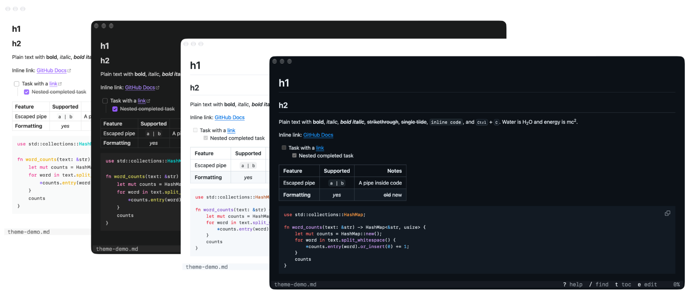

<h1 align="center">
  <br/>
  mddog
</h1>

<p align="center">
  <a href="https://github.com/qu8n/mddog/releases/latest"></a>
  <a href="LICENSE"></a>
  
  
</p>

<p align="center">
  Preview Markdown in your terminal the way a browser renders it.
</p>

https://github.com/user-attachments/assets/dbb4fddc-95a9-47dd-afcf-ce04fe8b5002

mddog fetches the Markdown (pun intended), turns it into a styled HTML page, renders the page in an off-screen [WKWebView](https://developer.apple.com/documentation/webkit/wkwebview) window, and sends the result to the terminal, allowing you to see and interact with the Markdown as you would in a browser.

## Features



- Preview Markdown/MDX with real fonts, Mermaid diagrams, math, and more
- Keyboard-first navigation with vim-like key bindings
- Mouse support for scrolling, clicking links, and selecting text
- Automatically reload when the file changes

## Prerequisites

- macOS
- A terminal that supports the [kitty graphics protocol](https://sw.kovidgoyal.net/kitty/graphics-protocol/): Ghostty, kitty, WezTerm, or iTerm2

## Install or update

```sh
curl -fsSL https://raw.githubusercontent.com/qu8n/mddog/main/install.sh | sh
```

<details>
<summary>What this script does</summary>

Running this script installs the latest release of mddog. It also registers a small launchd job that starts mddog with WebKit loaded at login, so the first preview after login opens faster. To opt out of this, run `mdd --no-start-at-login` after installing or set the environment variable `MDDOG_NO_START_AT_LOGIN=1` before running the script.

If you want to build from source instead, install [Rust](https://rust-lang.org/tools/install/) first, then run the following commands:

```bash
git clone https://github.com/qu8n/mddog.git
cd mddog
cargo install --path .
mdd --start-at-login
```

</details>

## Usage

```sh
mdd README.md    # preview a file
mdd              # list Markdown files in the current git repo or directory to pick from
mdd <directory>  # list Markdown files in a directory to pick from
```

Press `?` when inside the preview to see all the key bindings.


## Claude Code plugin

### Install or update

Install mddog first. Then, in a terminal with Claude Code installed, run:

```sh
claude plugin marketplace add qu8n/mddog && claude plugin install mddog@mddog
```

To update, run the mddog install script again, then:

```sh
claude plugin marketplace update mddog && claude plugin update mddog@mddog
```

Then start a new session or run `/reload-plugins`.

### Usage

- Inside a Claude Code session, open a file with `/mddog @<file.md>` or `/mddog <file.md>`, or ask Claude to show you one.
- Scroll with the mouse wheel, or click the pane and use the arrow and page keys.

Note: Claude Code only shows images in the terminals it knows, like Ghostty, kitty, iTerm2, and WezTerm. In other places, start it with `CLAUDE_CODE_FORCE_TERMINAL_IMAGES=1 claude`.

## Config (optional)

Configure your mddog at `~/.config/mddog/config.toml`. See [`config.example.toml`](config.example.toml) for every option.

Four themes are provided: `github-light`, `github-dark`, `obsidian-light`, and `obsidian-dark`. To tweak the current theme, add CSS to `~/.config/mddog/style.css`. To write your own theme, see [docs/themes.md](docs/themes.md).

## Limitations

- `Cmd-c` works only when the terminal passes it to mddog, as Ghostty and kitty do, instead of running its own copy. To make this work in WezTerm, set `enable_kitty_keyboard = true` and remove its `Cmd-c` binding. In iTerm2, set `copy_on_select = true` in mddog's config instead as a workaround.
- mddog refuses to run in Warp and zellij, whose bugs garble scrolling ([Warp#16424](https://github.com/warpdotdev/Warp/issues/16424), [zellij#5573](https://github.com/zellij-org/zellij/issues/5573)). In a multiplexer running inside Warp, mddog can't tell and runs anyway, with the same garbling.
- No tmux support as it can't show images yet ([tmux#5445](https://github.com/tmux/tmux/pull/5445)).
- In herdr, scrolling lags in most terminals except for Ghostty ([herdr#5512](https://github.com/herdrdev/herdr/issues/5512)). Starting herdr with `TERM_PROGRAM=ghostty herdr` fixes it, but then herdr also treats the terminal as Ghostty for notifications and focus.
