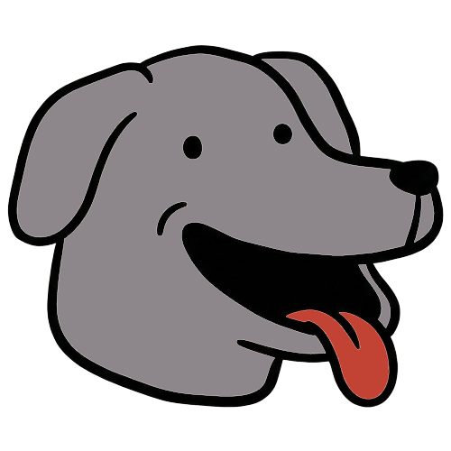
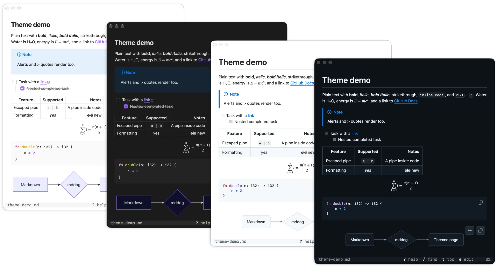

<h1 align="center">
  <br/>
  mddog
</h1>

<p align="center">
  <a href="https://github.com/qu8n/mddog/releases/latest"></a>
  <a href="LICENSE"></a>
  
  
</p>

<p align="center">
  Preview Markdown in your terminal the way a browser renders it.
</p>

https://github.com/user-attachments/assets/3a6fda37-b0d3-4678-bff6-7a5085d48719

mddog fetches the Markdown (pun intended), lays it out and draws it with macOS's own text and graphics engines in GitHub's style, and sends the result to the terminal, so you see and use the Markdown as you would in a browser.

## Features



- Preview Markdown with real fonts, Mermaid diagrams, math, and more
- Look like GitHub or Obsidian, in light or dark to match macOS
- Search, a table of contents, and a fuzzy file list
- Keyboard-first navigation with vim-like key bindings
- Mouse support for scrolling, clicking links, and selecting text
- Automatically reload when the file changes

## Prerequisites

- macOS
- A terminal that supports the [kitty graphics protocol](https://sw.kovidgoyal.net/kitty/graphics-protocol/): Ghostty, kitty, WezTerm, or iTerm2

## Install or update

```sh
curl -fsSL https://raw.githubusercontent.com/qu8n/mddog/main/install.sh | sh
```

<details>
<summary>What this script does</summary>

The script downloads the latest release of mddog, checks its checksum, and puts `mdd` in `~/.local/bin`. Set `MDDOG_INSTALL_DIR` to pick another folder. mddog doesn't leave anything running in the background.

If you want to build from source instead, install [Rust](https://rust-lang.org/tools/install/) first, then run the following commands:

```bash
git clone https://github.com/qu8n/mddog.git
cd mddog
cargo install --path .
```

</details>

## Usage

```sh
mdd README.md    # preview a file
mdd              # list Markdown files in the current git repo or directory to pick from
mdd <directory>  # list Markdown files in a directory to pick from
cat notes.md | mdd  # preview standard input
```

Press `?` when inside the preview to see all the key bindings.

## Claude Code plugin

### Install or update

Install mddog first. Then, in a terminal with Claude Code installed, run:

```sh
claude plugin marketplace add qu8n/mddog && claude plugin install mddog@mddog
```

To update, run the mddog install script again, then:

```sh
claude plugin marketplace update mddog && claude plugin update mddog@mddog
```

Then start a new session or run `/reload-plugins`. Always update `mdd` and the plugin together: an older `mdd` can't draw the pane in the desktop app.

### Usage

- Inside a Claude Code session, open a file with `/mddog @<file.md>` or `/mddog <file.md>`, or ask Claude to show you one. The pane works in the terminal and in the Claude Code desktop app.
- Scroll with the mouse wheel, or click the pane and use the arrow and page keys.
- The pane refreshes when the file changes.
- If Claude opens the pane and it doesn't appear, the terminal is too narrow. Zoom out, or run `/mddog <file.md>` yourself.
- To run a different `mdd` binary, set `MDDOG_BIN`.
- If `/mddog` is the first message of a new session, the app shows "/mddog isn't a command here", but the command still runs. The app checks that first message before mddog has registered `/mddog`, so later calls show no note.

Note: Claude Code only shows images in the terminals it knows, like Ghostty, kitty, iTerm2, and WezTerm. In other places, start it with `CLAUDE_CODE_FORCE_TERMINAL_IMAGES=1 claude`.

## Config (optional)

Configure your mddog at `~/.config/mddog/config.toml`, or `$XDG_CONFIG_HOME/mddog/config.toml` when that is set. See [`config.example.toml`](config.example.toml) for every option.

Four themes are provided: `github-light`, `github-dark`, `obsidian-light`, and `obsidian-dark`. By default mddog uses the GitHub pair and follows the macOS appearance. The Obsidian themes restyle the whole page like Obsidian's reading view. A theme is a token file that sets colors, fonts and sizes. `style.css` and themes written in arbitrary CSS are no longer read. To write your own theme, see [docs/themes.md](docs/themes.md).

mddog draws text with font smoothing when macOS does, which it reads from `defaults -g AppleFontSmoothing` at startup (0 turns it off). Set `font_smoothing = true` or `false` to choose for mddog alone.

## Limitations

- `Cmd-c` works only when the terminal passes it to mddog, as Ghostty and kitty do, instead of running its own copy. To make this work in WezTerm, set `enable_kitty_keyboard = true` and remove its `Cmd-c` binding. In iTerm2, set `copy_on_select = true` in mddog's config instead as a workaround.
- mddog refuses to run in Warp and zellij, whose bugs garble scrolling ([Warp#16424](https://github.com/warpdotdev/Warp/issues/16424), [zellij#5573](https://github.com/zellij-org/zellij/issues/5573)). In a multiplexer running inside Warp, mddog can't tell and runs anyway, with the same garbling.
- No tmux support as it can't show images yet ([tmux#5445](https://github.com/tmux/tmux/pull/5445)).
- In herdr, scrolling lags in most terminals except for Ghostty ([herdr#5512](https://github.com/herdrdev/herdr/issues/5512)). Starting herdr with `TERM_PROGRAM=ghostty herdr` fixes it, but then herdr also treats the terminal as Ghostty for notifications and focus.
- In the Claude Code desktop app, the plugin's pane can't click links or select text.
