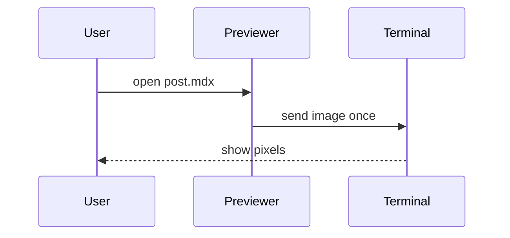

This synthetic post mixes Markdown, a Mermaid diagram, and custom components. The previewer never runs JSX, so each component shows as its source in a code block.

## How a render flows



```jsx
<Callout title="Heads up" type="warn">

Components show as JSX source. **Markdown** inside a component stays as text, including [links](https://example.com).

</Callout>
```

Press the keys below to open the editor:

```jsx
<KeySequence combo={[['Ctrl', 'e']]} />
```

## Notes

- Imports and exports are hidden.
- Frontmatter shows as a table, the same way GitHub shows it.
- Code keeps its highlighting:

```ts title="width.ts"
export const cssWidth = (cols: number, cellPx: number, scale: number) =>
  Math.floor((cols * cellPx) / scale);
```

The post ends here.
