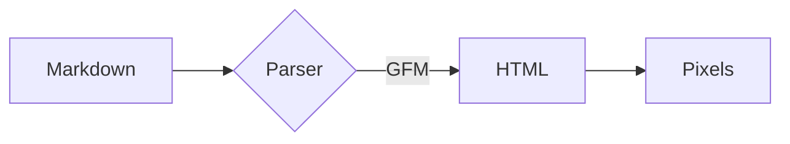

# Fixture: GitHub Flavored Markdown

This synthetic README exercises every GFM feature that the previewer supports. It is not real documentation, and each section of the fixture covers one feature.

## Text formatting

Plain text with **bold**, *italic*, ***bold italic***, ~~strikethrough~~, ~single tilde~, `inline code`, and <kbd>Ctrl</kbd> + <kbd>C</kbd>. Water is H<sub>2</sub>O and energy is mc<sup>2</sup>.

A line that ends with two spaces  
breaks here, and a backslash\
breaks here too.

Escapes stay literal: \*not emphasis\*, \`not code\`, and entities render: &copy; &rarr; &frac12;.

### Links and autolinks

- Inline link: [GitHub Docs](https://docs.github.com/en/get-started)
- Reference link: [CommonMark spec][spec]
- Angle autolink: <https://github.github.com/gfm/>
- Extended autolinks: https://example.com/path?query=1, www.example.org, and octocat@example.com
- Relative link: [the diagram fixture](diagram.svg)
- Heading link: [jump to Tables](#tables)

[spec]: https://spec.commonmark.org/0.31.2/ "CommonMark Spec"

## Lists

1. First ordered item
2. Second item with a nested list:
   - nested bullet
   - another nested bullet
     1. deeply nested ordered item
3. Third item

* Loose list item one

* Loose list item two

5. A list that starts at five
6. And continues at six

### Task lists

- [x] Completed task
- [ ] Open task with `code`
- [ ] Task with a [link](https://example.com)
  - [x] Nested completed task
  - [ ] Nested open task

## Tables

| Feature | Supported | Notes |
| :------ | :-------: | ----: |
| Tables | yes | Left, center, and right alignment |
| Escaped pipe | `a \| b` | A pipe inside code |
| **Formatting** | *yes* | ~~old~~ new |
| Long cell | no | This cell holds enough words to wrap when the fixture is narrow |

## Code

```js
// Debounce a function so it runs once input settles.
export function debounce(fn, wait = 100) {
  let timer;
  return (...args) => {
    clearTimeout(timer);
    timer = setTimeout(() => fn.apply(this, args), wait);
  };
}
```

```rust
use std::collections::HashMap;

/// Count how often each word appears.
fn word_counts(text: &str) -> HashMap<&str, usize> {
    let mut counts = HashMap::new();
    for word in text.split_whitespace() {
        *counts.entry(word).or_insert(0) += 1;
    }
    counts
}
```

```python
from dataclasses import dataclass


@dataclass
class Point:
    x: float
    y: float

    def norm(self) -> float:
        return (self.x ** 2 + self.y ** 2) ** 0.5
```

```bash
#!/usr/bin/env bash
set -euo pipefail
for f in *.md; do
  echo "rendering $f"
done
```

```json
{
  "name": "fixture",
  "version": "1.0.0",
  "private": true,
  "keywords": ["markdown", "preview"]
}
```

```diff
- const width = cols * 8;
+ const width = cols * cellWidth;
```

```
A fenced block without a language.
```

    An indented code block.

## Alerts

> [!NOTE]
> Useful information that users should know, even when skimming.

> [!TIP]
> Helpful advice for doing things better or more easily.

> [!IMPORTANT]
> Key information users need to know to achieve their goal.

> [!WARNING]
> Urgent info that needs immediate user attention to avoid problems.

> [!CAUTION]
> Advises about risks or negative outcomes of certain actions.

> A regular blockquote.
>
> > With a nested quote inside it.

## Footnotes

Here is a footnote reference[^1] and a named footnote[^note].

[^1]: The first footnote of the fixture.
[^note]: A named footnote with **formatting** and a [link](https://example.com).

## Math

Inline math such as $E = mc^2$ and $\sqrt{a^2 + b^2}$ sits inside a sentence.

$$
\int_0^\infty e^{-x^2}\,dx = \frac{\sqrt{\pi}}{2}
$$

## Mermaid



## Images

A relative image:


A remote image:


## Raw HTML

<details>
<summary>Click to expand</summary>

Hidden content with **markdown** inside a details block.

</details>

<div align="center">
  
  <p>Centered with the <code>align</code> attribute.</p>
</div>

<script>alert("this script is stripped")</script>
<p onclick="alert('x')" style="color: red">Inline handlers and styles are stripped from this fixture paragraph.</p>
<iframe src="https://example.com"></iframe>

---

#### Heading level four

##### Heading level five

###### Heading level six

The fixture ends here.
